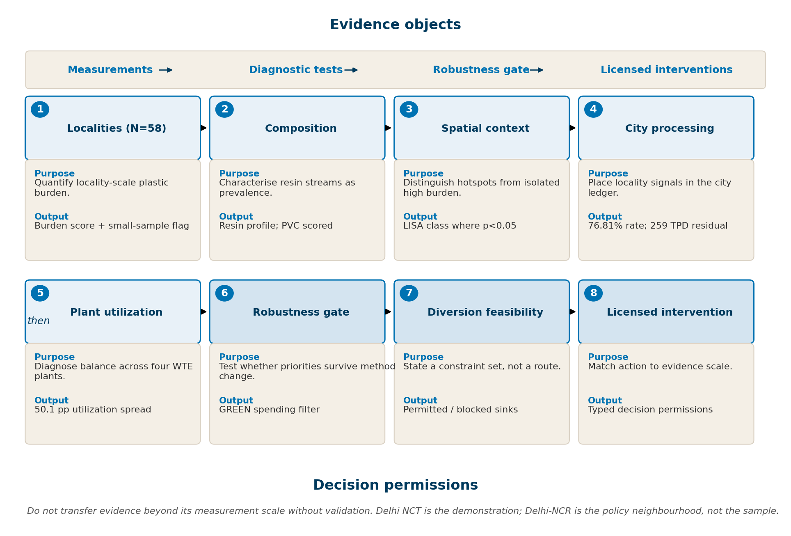
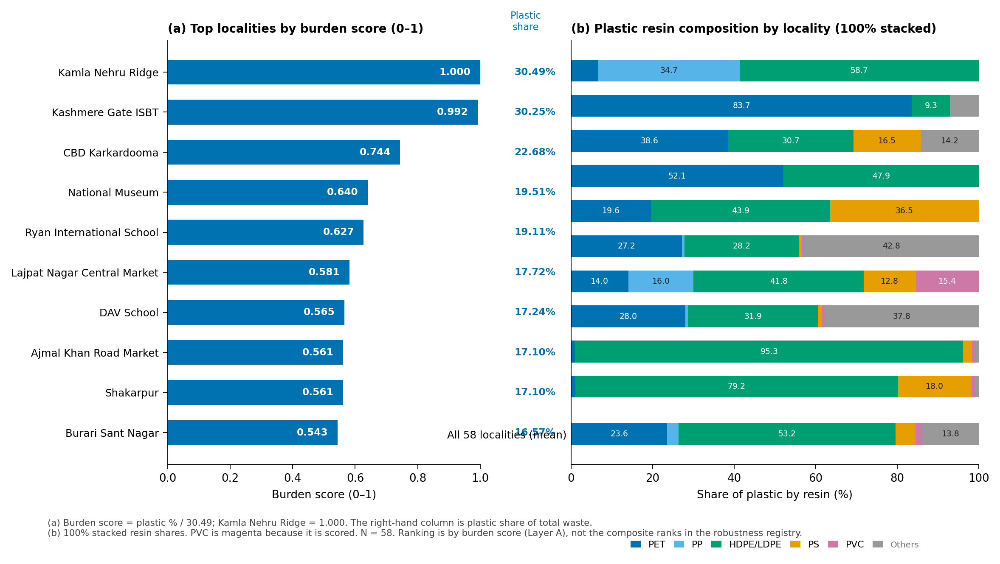
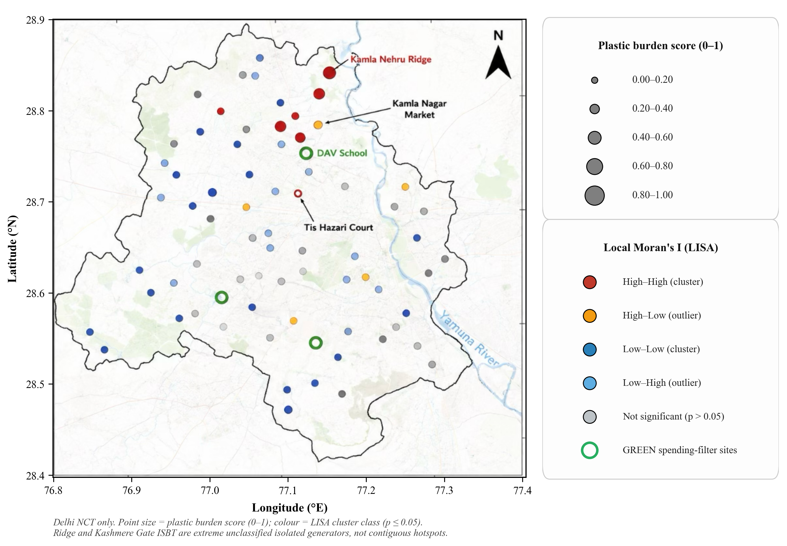
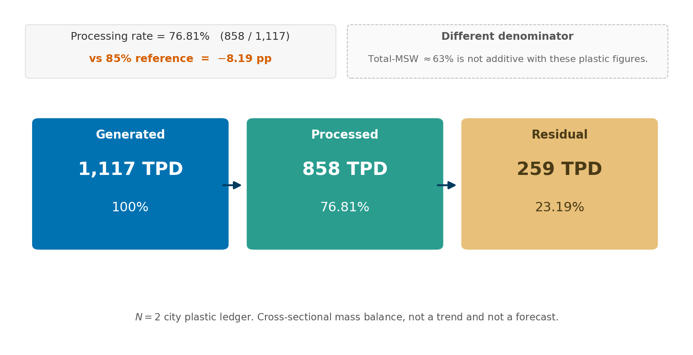
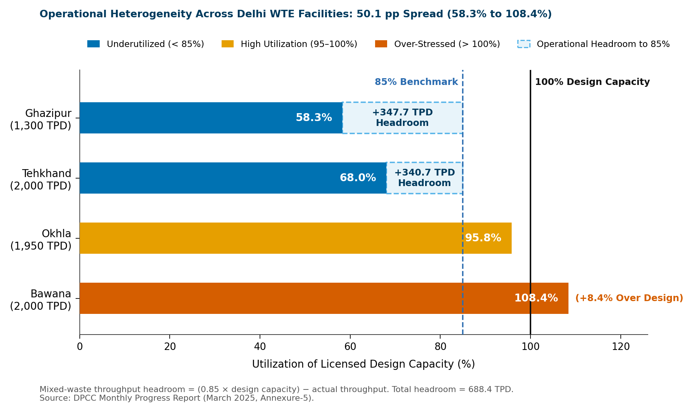
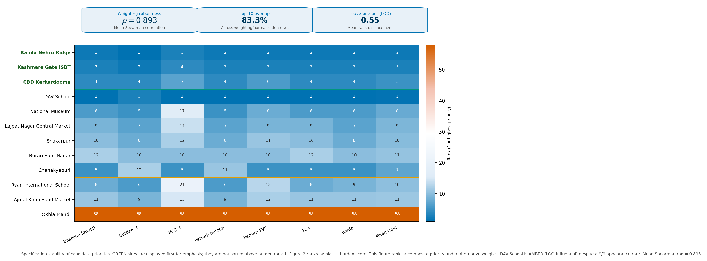
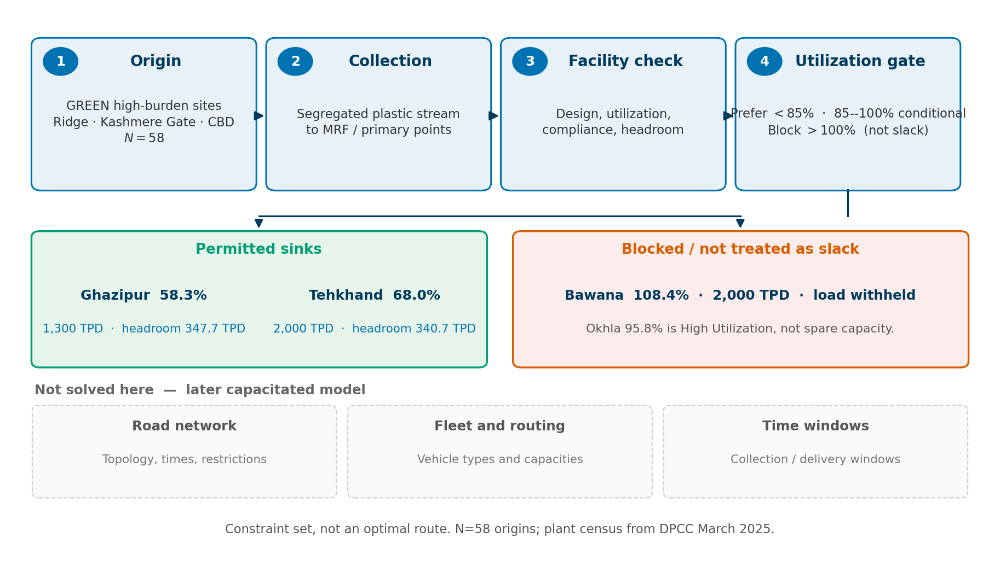
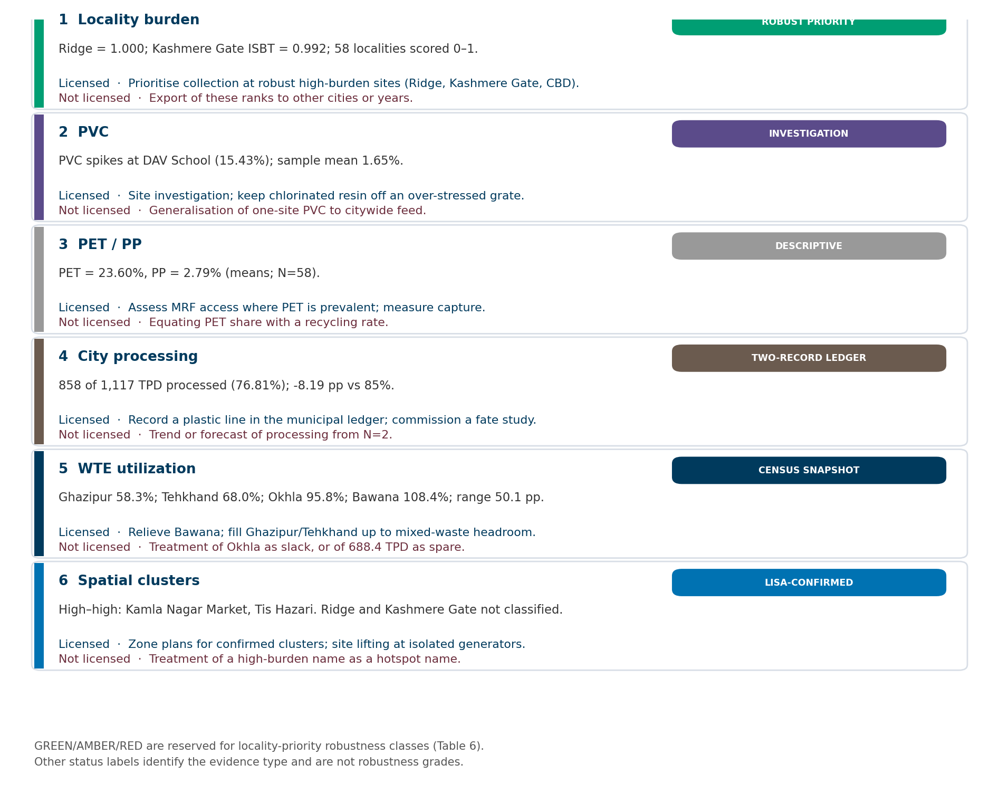

# Evidence-linked decision architecture for circular plastic waste management in cities

<strong>Sonal Khurana1,* and Yogay Jain1</strong> 
1Vivekananda Institute of Professional Studies – Technical Campus, New Delhi, India 
*Corresponding author: sonal.khurana@gmail.com

---

## Abstract
Urban circularity frameworks routinely collapse evidence gathered across disparate spatial scales, material fractions, and administrative ledgers into composite indices. This creates evidence-scale mismatch: conflating material prevalence with circular recovery, administrative accounting with plant capacity, or point-source generation with geographic hotspots. Here we formulate an evidence-linked decision architecture maintaining six empirical evidence objects on independent accounts and licensing interventions strictly within scale-appropriate boundaries. Applied to Delhi National Capital Territory across 58 complete-resin localities, plastic burden varies widely from 1.98% to 30.49%, yet spatial autocorrelation confirms that high-burden generators are isolated point peaks rather than contiguous clusters. At city scale, 76.81% processing leaves 259 tonnes per day unmonitored residual, while facility utilization spans 58.3% to 108.4%, exposing coexisting operational slack (688.4 tonnes per day headroom) and over-stress. Under a 72-specification robustness gate, only three localities qualify for immediate capital expenditure. This decision architecture prevents premature capital misallocation across global cities.

---

## 1. Introduction

Global plastic waste accumulation has reached an estimated 2.7 billion tonnes of unmanaged material across terrestrial and marine sinks1,2. Planetary statistics establish the ecological scale of material leakage, but they provide zero guidance for municipal dispatch, capital allocation, or neighborhood beat design3,4. The fundamental bottleneck in urban circularity is not merely lack of municipal data, but an unaddressed *evidence-scale mismatch*: the unvalidated transfer of an empirical observation generated at one spatial boundary, material resolution, temporal window, or administrative ledger to justify capital investment or operational intervention at another scale5,6. 

In contemporary urban environmental management, this mismatch recurs across five structural dimensions (Table 1). First, *spatial mismatch* occurs when point-source locality waste samples are extrapolated to represent an entire metropolitan jurisdiction. Second, *temporal mismatch* arises when static, two-point administrative compliance filings are interpreted as longitudinal trends in processing capability. Third, *material mismatch* occurs when the physical prevalence of recyclable polymers (such as polyethylene terephthalate, PET) is conflated with realized industrial recovery or formal circular reprocessing. Fourth, *system-boundary mismatch* conflates plastic-specific processing ledgers with municipal solid waste (MSW) bulk aggregates. Fifth, *operational mismatch* treats thermal plant utilization percentages or calculated headroom as immediately dispatchable reverse-logistics routes. When municipal managers and corporate sustainability officers ignore these boundaries, scarce capital is misdirected: collection fleets are deployed to unclustered locations, Extended Producer Responsibility (EPR) fees are credited against uncaptured materials, and municipal debt is issued to finance facility expansion where existing assets sit underutilized7,8.

::: {.table-block}

<strong>Table 1. Diagnostic typology of five forms of evidence-scale mismatch</strong>

| Mismatch Form | Inadmissible Analytical Transfer | Concrete Manifestation in Delhi NCT | Operational & Environmental Cost |
| :--- | :--- | :--- | :--- |
| **Spatial Mismatch** | Extrapolating point-source locality waste samples to entire metropolitan territories. | Treating N = 58 sampled localities as a probability census of all 250 MCD wards; assuming Delhi ranks apply to NCR satellite cities. | Deploying uniform citywide collection fleets that bypass high-density transit generators while over-servicing low-plastic residential zones. |
| **Temporal Mismatch** | Interpreting two-point administrative compliance filings as longitudinal trends. | Using identical March and June 2025 DPCC Section VIII filings (N = 2) to assert processing improvements or declining plastic waste. | Delaying necessary capital maintenance or waste diversion under the false assumption that municipal processing is steadily rising. |
| **Material Mismatch** | Equating physical prevalence of recyclable polymers with realized industrial circularity. | Treating 83.68% PET prevalence at Kashmere Gate ISBT as evidence of high local circular economy performance. | Corporate and municipal greenwashing: certifying statutory EPR obligations against material that ends up in unsegregated dumps. |
| **System-Boundary Mismatch** | Direct mathematical comparison between plastic-specific ledgers and bulk MSW statistics. | Comparing the 76.81% plastic processing ratio with the Delhi Economic Survey’s 63% bulk MSW processing rate. | Confusing bulk organic composting capacity with plastic-specific mechanical sorting or thermal treatment capabilities. |
| **Operational Mismatch** | Treating static thermal plant headroom as immediately dispatchable reverse-logistics routes. | Assuming 688.4 TPD of combined WTE headroom at Ghazipur and Tehkhand can instantly absorb unsegregated municipal plastic. | Rerouting contaminated, unsegregated waste to underutilized grates without addressing downtime causes, boiler corrosion, or feeder logistics. |

:::

Delhi National Capital Territory (Delhi NCT) presents an ideal, highly pressurized empirical demonstration of this systemic failure. Producing approximately 11,328 tonnes per day (TPD) of MSW, the capital region faces conflicting policy signals: the Delhi Economic Survey reports an aggregate MSW processing rate of only 63% (leaving a 4,200 TPD deficit)9, whereas national EPR filings report over 20.7 million tonnes of plastic packaging recycled nationwide10,11. Concurrently, Delhi's four waste-to-energy (WTE) facilities operate under disparate technical and legal realities—ranging from chronic maintenance outages and effluent compliance notices to over-capacity thermal stress and air quality violations12,13. Municipal administrators reading only aggregate reports face a false dichotomy: either build costly new incinerators or assume national EPR targets automatically resolve local burdens.

To resolve this impasse, we develop an evidence-linked decision architecture that preserves the intrinsic scale of each empirical layer (Figure 1). Rather than computing an arbitrary composite "circularity score," our framework maintains six distinct evidence objects: (A) locality plastic burden and polymer composition, (B) spatial autocorrelation diagnostics, (C) citywide mass-balance ledgers, (D) facility utilization and operational headroom, (E) specification robustness classification, and (F) logistics diversion constraints. Each evidence layer produces a *typed intervention licence*—a formal administrative permission whose operational scope strictly matches the evidentiary boundary of the supporting data (Table 2).

::: {.figure-block}

<strong>Figure 1. Conceptual framework of the evidence-linked decision architecture.</strong> The schematic illustrates the six distinct evidence objects (A through F) maintained on separate accounting ledgers, their respective measurement scales and metrics, the diagnostic testing and robustness gates applied to each layer, and the resulting typed intervention licences. The architecture enforces epistemological discipline: empirical evidence is strictly prohibited from crossing spatial, material, temporal, or operational scales without an explicit, validated transfer licence.

:::

::: {.table-block}

<strong>Table 2. Typed intervention licences: matching decision scope to evidence scale</strong>

| Evidence Object | Measured Empirical Observation | Permitted Decision Licence | Explicitly Forbidden Inadmissible Action |
| :--- | :--- | :--- | :--- |
| **Locality Plastic Burden** | Plastic fraction spans 1.98% to 30.49% (N = 58); upper tail concentrated at Ridge (30.49%) and Kashmere Gate (30.25%). | Prioritize high-frequency containerized dock collection at surviving GREEN generators. | Asserting citywide plastic collection failure or applying uniform per-capita collection quotas across all municipal wards. |
| **Polymer Composition (PET/PP)** | High PET prevalence at Kashmere Gate (83.68%); HDPE/LDPE dominance across commercial markets (up to 95.28%). | Contract dedicated MRF sorting capacity and verify post-consumer bale off-take agreements. | Claiming realized circular recycling rates or certifying corporate EPR compliance without point-of-sale capture audits. |
| **Toxic Polymer Spikes (PVC)** | Severe PVC anomaly at DAV School (15.43% vs 1.65% sample mean). | Commission targeted on-site institutional audit to identify chlorinated plastic procurement sources. | Enacting a municipal-wide ban on educational institution plastics or extrapolating PVC risk across all Delhi schools. |
| **Spatial Autocorrelation (LISA)** | High-High clusters at Kamla Nagar and Tis Hazari; Ridge and Kashmere Gate are statistically unclassified isolated peaks. | Design contiguous zone-level collection compacts for confirmed clusters; assign dedicated point-stop skips to isolated peaks. | Treating isolated high-burden generators as spatial hotspots, or diluting commercial hotspot resources into diffuse residential beats. |
| **Citywide Processing Ledger** | 858 TPD processed of 1,117 TPD generated (76.81%), leaving an unmonitored residual of 259 TPD (N = 2). | Establish a dedicated plastic tracking ledger line and commission a municipal leakage-fate audit. | Extrapolating longitudinal circularity trends or combining plastic balances with bulk MSW composting accounts. |
| **Facility Utilization Census** | Extreme utilization spread across 4 plants (58.3% to 108.4%); 688.4 TPD headroom at Ghazipur/Tehkhand; Bawana at 108.4%. | Implement spatial diversion to relieve Bawana; resolve feeder and maintenance bottlenecks at Ghazipur/Tehkhand. | Issuing municipal debt for new incinerator construction, or treating high-utilization plants (Okhla, 95.8%) as unconstrained slack sinks. |
| **Robustness Sensitivity Gate** | Mean Spearman ρ = 0.893, but only 3 of 58 localities survive 72-specification testing; DAV School is LOO-influential. | Allocate immediate capital spend strictly to the 3 GREEN localities; hold DAV School at AMBER for targeted inspection. | Treating untested multi-criteria league tables as actionable budget lines, or funding method-sensitive candidate localities. |

:::

To operationalize this architecture, we address five core empirical research questions. First, we identify where and in what resin configurations plastic waste accumulates within the urban fabric. Second, we examine when high local plastic generation represents a contiguous spatial cluster requiring neighborhood-scale zoning, rather than an isolated point-source generator requiring dedicated on-site collection. Third, we evaluate how city-scale plastic processing efficiency relates to physical capacity utilization across municipal treatment infrastructure. Fourth, we test the structural robustness of localized intervention priorities when subjected to systematic multi-criteria and sample perturbations. Finally, we formulate reverse-logistics diversion networks that absorb certified facility headroom while strictly blocking overloaded treatment nodes.

---

## 2. Literature Review and Conceptual Boundaries

The scientific literatures required to support an urban circular plastic-waste dispatch architecture are specialized rather than absent. Specialization is the central difficulty. Each disciplinary stream answers a specific operational question with high internal validity, but terminates before the next decision threshold is reached. Prior research routinely operates within disciplinary silos: material scientists analyze polymer properties without modeling spatial generation; geographers map spatial clusters without auditing facility intake capacity; and industrial ecologists model regional material flows without testing the statistical stability of localized prioritization. 

What has been absent from urban sustainability science is a formal specification of the *evidentiary conditions* under which findings from one empirical scale can legitimately be transferred to another. Below, we synthesize the existing literature across five core domains, diagnose their underlying failure modes, and establish the evidentiary transfer boundaries that structure our decision grammar (Table 3).

### 2.1 Circularity metrics can confuse material prevalence with realized recovery
Global production, environmental leakage, and treatment-lag assessments have established the planetary magnitude of the plastic crisis1,2,3,4. These macro-assessments identify a systemic management challenge at global and national scales; however, they cannot identify a specific municipal neighborhood, a target polymer fraction, or an individual incinerator grate. 

Circularity terminology does not inherently resolve this scale deficit. More than one hundred competing definitions of the circular economy have been catalogued in the literature8, with terms such as "recovery," "cycling," and "regeneration" frequently used interchangeably in policy texts7,14. Indian circularity reviews identify the operational bottleneck not in an absence of statutory mandates, but in the severe deficit of source-specific material recovery infrastructure31,32. 

Material composition surveys approach the waste container, but commonly terminate at broad citywide averages6. Plastic-waste generation was quantified across 60 Indian cities by the Central Pollution Control Board (CPCB)6, and compositional variation across commercial, residential, and industrial area types has been documented for Delhi NCT, identifying a wide polyvinyl chloride (PVC) spread (2.85% to 10.23%) across land-use classes22. Standard operating procedures for plastic assessment were updated in 202433, and mechanical recycling limits have been evaluated across virgin and post-consumer polymer streams34. 

Crucially, a measured polymer share represents a statement of *prevalence*, not a demonstration of *recovery*. If a sampled polyethylene terephthalate (PET) fraction is casually equated with localized circular recycling, subsequent municipal claims regarding Extended Producer Responsibility (EPR) compliance are constructed upon an invalid variable. Material prevalence establishes sorting potential; only verified post-collection capture licenses circularity claims.

### 2.2 Spatial studies can conflate localized burden with contiguous spatial concentration
Spatial statistics define the actionable operational unit that aggregate composition surveys cannot provide. Local Indicators of Spatial Association (LISA)30 and distance-based spatial autocorrelation statistics (Getis–Ord <i>Gi*</i>)35 formally separate a statistically significant hotspot—which warrants a contiguous, zone-level collection compact—from an isolated high-burden point outlier, which warrants a dedicated on-site containerized skip, and from an unclassified point, which warrants neither. 

While spatial autocorrelation methods have been applied to bulk municipal solid waste (MSW) across ward-level units in Indian secondary cities such as Kota15, Lucknow, and Patna, two fundamental restrictions remain. First, prior spatial analyses evaluate bulk, mixed municipal waste rather than resin-resolved plastic burden. Second, spatial studies in this tradition rarely evaluate whether priority rankings survive systematic perturbations in multi-criteria weighting, mathematical normalization, or sample composition. 

Consequently, high local plastic burden and statistically confirmed spatial clustering are routinely treated as interchangeable in municipal planning. In operational reality, this conflation produces severe dispatch failures: a commercial market exhibiting a statistically confirmed High-High cluster requires a contiguous neighborhood collection beat, whereas a high-burden transit terminus exhibiting spatial isolation requires a dedicated point-source extraction protocol.

### 2.3 Citywide processing indicators mask acute infrastructure heterogeneity
Municipal mass balances answer gross volumetric accounting: how much waste is collected and treated across a metropolitan territory, rather than where operational bottlenecks reside. Solid waste management in Indian megacities, and Delhi specifically, has historically been reviewed as an aggregate capacity and governance deficit23,36. The *Delhi Economic Survey 2025–26* reports that approximately 63% of bulk MSW is processed, leaving an unmanaged residual of approximately 4,200 TPD out of roughly 11,862 TPD generated17. Official municipal status filings, segregation roadmaps, and facility expansion notices uniformly focus on aggregate mixed-waste shortfalls20,21. 

However, gross citywide percentages cannot diagnose a multi-facility processing network. Slack facilities remain unidentified, and the specific fate of unmonitored plastic residuals is obscured. Engineering appraisals of waste-to-energy (WTE) infrastructure evaluate thermodynamic cycles, flue gas treatment, and life-cycle carbon balances at the aggregate system scale24,37,38. Yet Delhi's operational WTE facilities are never categorized by dynamic utilization ratios within this literature, and spatial generation nodes are never linked to individual receiving grates. 

Operating reality arrives through statutory regulatory disclosures: the DPCC March 2025 census snapshot reveals that Delhi's four operational plants exhibit extreme capacity divergence, spanning a 50.1 percentage-point spread (from 58.3% at Ghazipur to 108.4% at Bawana)20. Furthermore, independent regulatory reporting documents 108 days of complete shutdown at Ghazipur during FY2025–26, while a CPCB affidavit before the National Green Tribunal flagged Bawana for severe dioxin/furan exceedances and Tehkhand for effluent violations, leaving Okhla as the sole facility meeting all environmental standards21. Plant availability, statutory emissions compliance, and throughput-to-capacity ratios represent fundamentally distinct operational instruments. Allocating capital based on generic technology reviews, without auditing real-time facility load ratios, inevitably misdirects public investments.

### 2.4 Reverse-logistics modeling requires network feasibility before route optimization
Reverse logistics defines the mathematical modeling structure that prioritized localities and classified facilities must enter. Secondary collection and reverse transport have been extensively optimized across operations research literature through vehicle routing problem (VRP) formulations where road networks, fleet capacities, time windows, and operating costs are fully observed16,27,28. 

In municipal waste reality, however, these detailed routing parameters are rarely accessible in administrative datasets. Physical utilization at the treatment facility represents the critical missing constraint layer: an underutilized facility can be modeled as a candidate sink (strictly up to its certified operational headroom); a chronically over-stressed facility must be formulated as a blocked node; and a high-utilization facility must be preserved without being treated as an unconstrained sink. This formulation establishes the mathematical *feasibility conditions* that must precede route optimization. Feasibility strictly precedes optimization: deploying vehicle routing algorithms on unconstrained networks risks routing diverted municipal plastics directly into already over-stressed incinerators while stranding verified headroom elsewhere in the city.

### 2.5 Multi-criteria prioritization and specification robustness
Even when localities are ranked using multi-criteria indicators, a point-score ranking is not yet an actionable capital budget line. Multiple-criteria decision analysis (MCDA) and global sensitivity theory have long demonstrated that rank stability under specification uncertainty constitutes an intrinsic property of the decision object itself, rather than a secondary sensitivity check25,26. Composition and WTE studies rarely evaluate whether priority lists represent robust empirical signals or mathematical artefacts of scaling, weighting, or sample inclusion.

Concurrently, Extended Producer Responsibility (EPR) regulations in India have accelerated dramatically—mandating statutory recycling obligations in 2022 and recycled-content thresholds by 2026, with over 20.7 million tonnes of plastic packaging registered as recycled nationally18,19. Yet, national EPR certificates cannot be disaggregated to individual Delhi NCT wards, and they provide zero spatial intelligence to guide a municipal dispatcher. A dispatch algorithm that ignores facility utilization and rank robustness risks directing public resources toward method-sensitive localities while compounding toxic combustion risks at over-stressed grates.

### 2.6 What remains missing: The cross-scale transfer boundary
The existing scientific literature therefore contains the individual components of an urban circularity system, but consistently fails to specify the *evidentiary conditions* under which findings from one component can legitimately be transferred to the next. Material prevalence is conflated with circular recovery (material mismatch); two-point compliance records are conflated with longitudinal trends (temporal mismatch); locality sample shares are conflated with citywide averages (spatial mismatch); municipal mass balances are conflated with physical plant capacities (system-boundary mismatch); and facility headroom is conflated with an optimized routing schedule (operational mismatch). 

Table 3 formalizes these eight evidence streams against their respective transfer boundaries. By defining what each empirical layer measures, what decisions it can legitimately support, and what policy overreaches are strictly prohibited, our decision architecture establishes the transferable decision grammar that bridges these unconnected literatures.

::: {.table-block}

<strong>Table 3. Systematic comparison of urban plastic-waste evidence streams and scale transfer boundaries</strong>

| Evidence Stream | Measurement Object & Scale | What It Can Support | What It Cannot Support (Overreach) | Required Transfer Condition |
| :--- | :--- | :--- | :--- | :--- |
| **Global Plastic Mass**1–4 | Planetary production, leakage, and treatment lag. | Public awareness; international treaty targets; macro-scale problem framing. | Neighborhood collection design; local polymer quotas; plant dispatch. | Direct local empirical measurement of the physical material stream. |
| **Circular Economy Constructs**7,8,14 | Conceptual circularity paradigms; recovery taxonomy; national policy roadmaps. | High-level regulatory framing; identification of institutional recovery gaps. | Auditing EPR performance at a specific municipal ward or facility grate. | Verified chain-of-custody capture and post-collection processing data. |
| **Material Composition Surveys**6,22,33 | Resin-specific mass prevalence across urban land-use categories. | Material-specific screening; identifying high-prevalence PET or toxic PVC sites. | Asserting circular recycling rates or certifying corporate EPR compliance. | Field-level recovery and mechanical reprocessing verification. |
| **Spatial Association Statistics**15,30,35 | Local spatial autocorrelation (LISA <i>Ii</i>, Getis–Ord <i>Gi*</i>) across point locations. | Demarcating contiguous zone-level collection compacts (<i>p</i> &le; 0.05). | Inferring causal mechanisms; treating isolated point peaks as spatial hotspots. | Spatial diagnostic testing at the precise decision unit with significance gates. |
| **Citywide Processing Ledgers**17,20,23 | Metropolitan aggregate processed-to-generated mass ratios. | Macro-system monitoring; alerting administrators to unmonitored mass deficits. | Diagnosing plant-specific bottlenecks or establishing localized diversion routes. | Disaggregated facility-level census records and operational logs. |
| **Facility Operations & Utilization**20,21,24 | Plant-specific throughput, licensed capacity, downtime, statutory compliance. | Identifying candidate sink nodes, blocked nodes, and operational headroom. | Assuming unconstrained absorption capacity or generating turn-by-turn routes. | Continuous availability records, emissions audits, and feed-stream specs. |
| **Rank Robustness Diagnostics**25,26 | Rank persistence and displacement under multi-criteria perturbations. | Screening robust capital intervention priorities (GREEN gate certification). | Authorizing public capital expenditure based on an untested, single-model rank. | Multi-model sensitivity auditing across weights, scaling, and LOO tests. |
| **Reverse Logistics Formulations**16,27,28 | Network origins, sink capacities, and spatial diversion feasibility. | Establishing mathematical constraint sets for feasible waste redirection. | Claiming an already-solved, turn-by-turn vehicle routing schedule. | Observed street network graphs, fleet availability, and real-time transit costs. |

:::

---

## 3. Results

### 3.1 Locality plastic burden and polymer prevalence
Empirical characterization across 58 geographically validated localities in Delhi NCT reveals extreme localized variation in plastic generation (Figure 2 and Table 4). Total plastic waste fractions range from 1.98% in Inderlok (a dense residential enclave) to 30.49% at Kamla Nehru Ridge (a park/recreational boundary), with a sample mean of 10.82% (± 6.10%) and a median of 8.94%. The upper tail exhibits sharp concentration: only three localities exceed 20% plastic by mass (Kamla Nehru Ridge at 30.49%, Kashmere Gate ISBT at 30.25%, and CBD Karkardooma at 22.68%). 

This wide dispersion exposes the failure of uniform municipal collection models. Standard municipal practice deploys uniform collection beats based on gross population density, assuming waste composition remains homogeneous across wards22,23. In Delhi, per-capita waste assumptions generate massive operational distortions: applying identical collection routines to Inderlok (1.98% plastic) and Kashmere Gate ISBT (30.25% plastic) starves high-plastic transit nodes of container capacity while running underutilized collection trucks through low-plastic residential wards. 

::: {.figure-block}

<strong>Figure 2. Locality-level plastic waste burden and polymer composition (N = 58).</strong> <strong>(a)</strong> Ranked bar chart of the top ten plastic burden localities in Delhi NCT, displaying observed plastic percentage (left axis) and normalized plastic burden score relative to the sample maximum (right axis; Kamla Nehru Ridge = 1.000). Small-sample flags (&lt; 10 kg) are marked with asterisks. <strong>(b)</strong> 100% stacked bar chart of polymer resin composition across the top ten localities, disaggregated into PET, HDPE/LDPE, PVC, PP, PS, and Others. Data establish material prevalence, not realized recycling or recovery rates.

:::

Polymer resin characterization across the six standardized resin codes disaggregates this aggregate burden into distinct material streams (Figure 2b). Polyethylene fractions (HDPE and LDPE combined) dominate the baseline, averaging 53.24% (± 24.49%) and reaching 95.28% in commercial markets such as Shakarpur, driven by single-use carry bags and packaging films. Polypropylene (PP) averages 2.79% across the city but spikes to 34.67% at Kamla Nehru Ridge. Polyethylene terephthalate (PET) averages 23.60% (± 20.27%) across the sampling universe, but exhibits an acute concentration peak at Kashmere Gate ISBT (83.68% of sampled plastic), driven by high-density passenger transit beverage consumption.

Crucially, polymer prevalence does not equal circular material recovery. High PET prevalence at Kashmere Gate ISBT indicates an exceptional target for dedicated clean material recovery facility (MRF) intake; it does not demonstrate that this PET is currently sorted, baled, or recycled. If an urban local body or brand owner credits this 83.68% PET prevalence toward statutory EPR recycling mandates without field-level capture verification, the resulting claim constitutes material mismatch. 

Furthermore, the compositional data identify acute environmental and operational hazards. Polyvinyl chloride (PVC) averages only 1.65% (± 2.41%) across Delhi, but spikes to 15.43% at DAV School (Table 4). Chlorinated plastics represent severe poison pills in circular systems: in mechanical recycling, PVC thermally degrades and acidifies PET melts, rendering recycled flakes brittle and commercially unsellable; in thermal WTE systems, PVC combustion generates toxic polychlorinated dibenzo-p-dioxins and furans (PCDD/Fs) alongside hydrochloric acid gas that corrodes boiler tubes14,15. Yet, treating this 15.43% site measurement as justification for a blanket municipal ban on educational institution procurement represents an invalid spatial overreach. As specified by our architecture, this finding licenses a site-specific source-segregation audit at DAV School, while withholding citywide regulatory penalties.

::: {.table-block}

<strong>Table 4. Locality plastic burden and polymer composition baseline (N = 58, selected top-ranked and diagnostic sites)</strong>

| Locality Name | Sampled Plastic % | Normalized Burden Score | PET % | HDPE/LDPE % | PVC % | PP % | PS % | Others % | Robustness Class |
| :--- | :--- | :--- | :--- | :--- | :--- | :--- | :--- | :--- | :--- |
| **Kamla Nehru Ridge** | 30.49 | 1.000 | 6.67 | 58.67 | 0.00 | 34.67 | 0.00 | 0.00 | **GREEN** (small sample) |
| **Kashmere Gate ISBT** | 30.25 | 0.992 | 83.68 | 9.30 | 0.00 | 0.00 | 0.00 | 7.02 | **GREEN** |
| **CBD Karkardooma** | 22.68 | 0.744 | 38.58 | 30.71 | 0.00 | 0.00 | 16.54 | 14.17 | **GREEN** (small sample) |
| **National Museum** | 19.51 | 0.640 | 52.10 | 47.90 | 0.00 | 0.00 | 0.00 | 0.00 | **AMBER** |
| **Ryan International School** | 19.11 | 0.627 | 19.63 | 43.93 | 0.00 | 0.00 | 36.45 | 0.00 | **RED** |
| **Lajpat Nagar Central Market** | 17.72 | 0.581 | 14.11 | 55.31 | 1.13 | 0.00 | 10.16 | 19.29 | **AMBER** |
| **DAV School** | 17.24 | 0.565 | 14.04 | 41.76 | 15.43 | 16.01 | 12.76 | 0.00 | **AMBER** (LOO influential) |
| **Ajmal Khan Road Market** | 17.10 | 0.561 | 12.87 | 62.57 | 1.17 | 0.00 | 4.68 | 18.71 | **AMBER** |
| **Shakarpur** | 17.10 | 0.561 | 0.95 | 95.28 | 0.80 | 0.00 | 2.17 | 0.80 | **AMBER** |
| **Burari Sant Nagar** | 16.57 | 0.543 | 24.74 | 60.35 | 1.81 | 0.00 | 4.22 | 8.88 | **AMBER** |
| *Sample Mean (N = 58)* | **10.82** | **0.355** | **23.60** | **53.24** | **1.65** | **2.79** | **4.92** | **13.80** | — |
| *Standard Deviation* | **6.10** | **0.200** | **20.27** | **24.49** | **2.41** | **6.54** | **6.69** | **13.17** | — |

:::

### 3.2 Spatial association and cluster diagnostics
To evaluate whether localized plastic burdens represent geographically diffuse contamination or compact spatial targets, we coupled non-parametric group comparisons with spatial autocorrelation statistics (Figure 3 and Table 5). Kruskal–Wallis tests confirm that total plastic burden is significantly associated with socio-economic income classification (H = 14.00, ε² = 0.208, q = 0.012, FDR-adjusted) and urban land-use zoning (H = 14.83, ε² = 0.193, q = 0.022). High-income and mixed commercial-transit corridors generate higher plastic fractions than low-income residential peripheries. Conversely, PVC contamination shows no statistically significant association with income (H = 7.30, q = 0.084) or land-use (H = 6.53, q = 0.258), confirming that toxic chlorinated plastic occurs as idiosyncratic institutional and commercial spikes rather than systematic socio-economic gradients.

Descriptive spatial inequality metrics confirm structural concentration: the Gini coefficient for total plastic burden is 0.301, whereas the Gini coefficient for PVC reaches 0.586, reflecting heavy tail concentration. Global spatial autocorrelation across Delhi NCT is statistically indistinguishable from a random distribution (Global Moran's I = 0.053, p = 0.247 under 999 Monte Carlo permutations). This absence of global spatial dependence demonstrates that plastic pollution across a megacity does not diffuse smoothly across administrative ward boundaries.

::: {.figure-block}

<strong>Figure 3. Spatial heterogeneity and Local Indicators of Spatial Association (LISA) in Delhi NCT.</strong> Map of Delhi NCT displaying the 58 validated sampling localities. Bubble diameter represents normalized plastic burden score (Si ∈ [0, 1]). Bubble color denotes statistically significant local spatial association classes (p ≤ 0.05 under 999 conditional permutations): High-High hotspots (red; Kamla Nagar Market, Tis Hazari Court), Low-Low coldspots (blue; Madanpur Khadar, Dwarka Sector-12), spatial outliers (purple), and statistically unclassified points (grey). Rings highlight the three localities certified by the robustness gate. Note that extreme burden sites (Ridge and Kashmere Gate) are unclassified isolated generators, not LISA hotspots.

:::

Local Indicators of Spatial Association (LISA; k = 5 nearest neighbors, inverse-distance row-standardized weights) resolve the operational distinction between contiguous spatial zones and isolated point generators. Statistically significant High-High (hotspot) clusters emerge at Kamla Nagar Market (Ii = +2.183, p = 0.002) and Tis Hazari Court (Ii = +0.119, p = 0.028). Significant Low-Low (coldspot) clusters appear at Madanpur Khadar (Ii = +0.949, p = 0.006) and Dwarka Sector-12 (Ii = +0.228, p = 0.028). Spatial outliers include Civil Lines (Low-High, Ii = -2.157, p = 0.040) and Nizamuddin Railway Station (High-Low, Ii = -0.060, p = 0.040).

This spatial finding yields an immediate operational principle: *high burden does not imply a spatial cluster*. Delhi's two highest burden localities—Kamla Nehru Ridge (30.49%) and Kashmere Gate ISBT (30.25%)—are not LISA hotspots; they are statistically unclassified point generators surrounded by lower-burden urban buffers. Mistaking an isolated high-burden generator for a spatial hotspot leads to misdirected capital: municipal authorities would deploy area-wide sweepers and neighborhood awareness campaigns to surrounding residential wards, when the necessary operational intervention is dedicated on-site dock collection at the transit terminal and commercial container management at the ridge park. Conversely, Kamla Nagar Market represents a true multi-ward commercial hotspot, licensing contiguous zone-level infrastructure, such as dedicated reverse vending networks and consolidated merchant collection routes.

::: {.table-block}

<strong>Table 5. Spatial autocorrelation and LISA cluster diagnostics (k = 5 nearest neighbors, row-standardized)</strong>

| Locality Name | Ward / Zone | Dominant Land Use | Plastic Burden % | Local Moran’s Ii | Pseudo p-value | LISA Spatial Classification | Operational Decision Impact |
| :--- | :--- | :--- | :--- | :--- | :--- | :--- | :--- |
| **Kamla Nagar Market** | Ward 69, North | Commercial | 15.00 | +2.183 | 0.002 | **High-High (Hotspot)** | Design contiguous multi-ward commercial recycling zone. |
| **Tis Hazari Court** | Ward 83, North | Institutional | 11.53 | +0.119 | 0.028 | **High-High (Hotspot)** | Establish dedicated institutional paper/plastic sorting compact. |
| **Madanpur Khadar** | Ward 101-S, South East | Residential | 5.30 | +0.949 | 0.006 | **Low-Low (Coldspot)** | Maintain baseline municipal collection; withhold capex. |
| **Dwarka Sector-12** | Ward 36/38, Dwarka | Residential | 9.27 | +0.228 | 0.028 | **Low-Low (Coldspot)** | Eligible for waste diversion scenario to underutilized WTE. |
| **Civil Lines** | Ward 83, North | Residential | 6.75 | -2.157 | 0.040 | **Low-High (Spatial Outlier)** | Low-burden buffer adjacent to high-burden commercial core. |
| **Nizamuddin Rly Station** | South East | Transit / Public | 11.13 | -0.060 | 0.040 | **High-Low (Spatial Outlier)** | Dedicated terminal container collection; do not zone surrounding ward. |
| **Kamla Nehru Ridge** | Central Zone | Mixed / Park | 30.49 | — | >0.05 | **Unclassified (Isolated Peak)** | Highest city burden; dedicated park dock collection; not a LISA zone. |
| **Kashmere Gate ISBT** | North Zone | Transit / Public | 30.25 | — | >0.05 | **Unclassified (Isolated Peak)** | Dedicated transit dock collection; do not zone surrounding residential area. |

:::

### 3.3 Citywide processing balance and facility utilization heterogeneity
At the municipal system scale, official administrative records from the Delhi Pollution Control Committee (DPCC) Section VIII report an estimated plastic generation of 1,117 TPD against 858 TPD processed, recorded identically across March and June 2025 (Figure 4 and Table 6)12. This yields an aggregate plastic processing efficiency of 76.81%, leaving an unmonitored residual of 259 TPD. 

Interpreting this 76.81% ratio requires strict epistemological discipline. Because it is derived from identical administrative ledger filings (N = 2), it represents an accounting balance rather than an empirical trend. It cannot be combined with or compared against the Delhi Economic Survey's 63% MSW bulk processing rate because the denominators and accounting methodologies diverge completely9. The 259 TPD plastic residual represents unmanaged material that either leaks into informal dumping, escapes into drainage networks, or accumulates in legacy dumpsites. This ledger balance licenses an immediate municipal fate study and targeted corporate packaging audits under EPR; it does not license a diagnosis of physical processing capacity.

::: {.figure-block}

<strong>Figure 4. Municipal plastic mass balance and processing ledger.</strong> Sankey diagram and mass-balance ledger illustrating city-scale plastic flows reported in DPCC Section VIII filings (March and June 2025). Estimated generation (1,117 TPD) divides into documented processed plastic (858 TPD; 76.81%) and an unmonitored processing residual (259 TPD; 23.19%). The 85% operational target benchmark leaves an 8.19 percentage-point municipal deficit. The balance represents a cross-sectional administrative ledger, not a longitudinal trend.

:::

::: {.table-block}

<strong>Table 6. Citywide municipal plastic mass balance (DPCC Section VIII administrative ledger)</strong>

| Material Ledger Stream | Daily Mass (TPD) | Municipal Share (%) | Regulatory Reporting Reference | Epistemological Nature of Metric | Operational Interpretation |
| :--- | :--- | :--- | :--- | :--- | :--- |
| **Estimated Plastic Generated** | 1,117.0 TPD | 100.00% | DPCC Section VIII (March & June 2025) | Administrative Ledger Snapshot | Baseline citywide plastic generation estimate. |
| **Documented Plastic Processed** | 858.0 TPD | 76.81% | DPCC Section VIII (March & June 2025) | Administrative Ledger Snapshot | Certified plastic processed across formal facilities. |
| **Unmonitored Processing Residual**| 259.0 TPD | 23.19% | Calculated Arithmetic Residual | Ledger Remainder (Not Monitored) | Escapes into drains, dumpsites, or informal burning. |
| **85% Target Operational Benchmark**| 949.5 TPD | 85.00% | Policy Planning Target | Benchmark Threshold | Leaves an 8.19 percentage-point municipal deficit. |
| *Context: Total MSW Processing* | *7,137.0 TPD* | *63.00%* | *Delhi Economic Survey 2025–26* | *Distinct Denominator (Bulk MSW)* | *Non-additive with plastic-specific accounts.* |

:::

Physical treatment capacity must be evaluated on its own dedicated ledger (Figure 5 and Table 7). Delhi's four operational WTE facilities exhibit an aggregate design capacity of 7,250 TPD against an actual throughput of 6,152.0 TPD, yielding a mean capacity utilization of 82.6%. However, this aggregate mean conceals extreme operational heterogeneity: plant utilization spans a 50.1 percentage-point spread, with a coefficient of variation of 28.3% across facilities. 

Ghazipur and Tehkhand operate well below capacity, exhibiting a combined mixed-waste throughput headroom of 688.4 TPD (347.7 TPD at Ghazipur and 340.7 TPD at Tehkhand to the 85% benchmark). This underutilization is directly corroborated by independent operational evidence: Ghazipur suffered 108 days of complete shutdown in FY2025–26 due to boiler maintenance and logistical bottlenecks13. Conversely, Bawana is operating at 108.4% of design capacity, exceeding its engineering envelope. Operating WTE combustion chambers beyond design capacity compromises flue gas residence times, suppresses bed temperatures, and impairs acid gas scrubbers. This operational over-stress aligns directly with a February 2026 Central Pollution Control Board (CPCB) affidavit before the National Green Tribunal, which cited Bawana for major dioxin and furan emission violations12. Okhla operates at 95.8% utilization, successfully meeting monitored emissions norms; it is actively constrained and cannot serve as a slack sink for diverted waste.

::: {.figure-block}

<strong>Figure 5. Waste-to-energy facility utilization and operational headroom.</strong> Operating profiles across Delhi's four WTE facilities based on the DPCC Annexure-5 census snapshot. Bars display actual throughput against licensed design capacity (horizontal dashes). Color shading designates operational classification: Underutilized (&lt; 85%; Ghazipur at 58.3%, Tehkhand at 68.0%), High Utilization (95–100%; Okhla at 95.8%), and Over-Stressed (&gt; 100%; Bawana at 108.4%). Green callout bands indicate mixed-waste throughput headroom to the 85% engineering threshold (totaling 688.4 TPD). Independent compliance flags (CPCB dioxin citations at Bawana and maintenance shutdowns at Ghazipur) are annotated.

:::

::: {.table-block}

<strong>Table 7. Waste-to-energy facility census and operational headroom classification (DPCC Annexure-5)</strong>

| Facility Name | Design Capacity (TPD) | Actual Throughput (TPD) | Utilization Ratio (%) | Operational Classification | Headroom to 85% Benchmark | Documented Compliance & Operating Reality |
| :--- | :--- | :--- | :--- | :--- | :--- | :--- |
| **Ghazipur** | 1,300 | 757.3 | 58.3% | **Underutilized** | +347.7 TPD | Suffered 108 days of complete shutdown in FY2025–26; aging infrastructure. |
| **Tehkhand** | 2,000 | 1,359.3 | 68.0% | **Underutilized** | +340.7 TPD | Modern facility operating below capacity; CPCB effluent notices flagged. |
| **Okhla** | 1,950 | 1,867.9 | 95.8% | **High Utilization** | 0.0 TPD | Operating near capacity; only Delhi plant meeting all CPCB emission norms. |
| **Bawana** | 2,000 | 2,167.5 | 108.4% | **Over-Stressed** | 0.0 TPD | Chronically overloaded; CPCB NGT affidavit cites dioxin/furan exceedances. |
| **System Total / Spread** | **7,250 TPD** | **6,152.0 TPD** | **Spread: 50.1 pp** | **Structural Imbalance** | **+688.4 TPD** | Coexisting slack (+688.4 TPD) and severe over-stress; CV = 28.3%. |

:::

This facility-level evidence fundamentally alters municipal capital strategy. The citywide deficit cannot be solved by building new WTE incinerators while Ghazipur and Tehkhand possess nearly 700 TPD of operational headroom. The immediate policy mandate is dual: first, relieve combustion over-stress at Bawana to mitigate toxic emissions; second, resolve intake logistics and feedstock sorting at Ghazipur and Tehkhand to utilize existing capital investments.

### 3.4 Priority robustness and the specification gate
In environmental multi-criteria decision analysis (MCDA), policy league tables are notoriously sensitive to subjective weighting choices and mathematical scaling methods16,17. If an urban local body allocates capital based on an unverified ranking, modest changes in policy priorities can cause target localities to drop out of the priority set, wasting public funds.

To eliminate this fragility, we subjected all 58 candidate localities to a 72-specification robustness gate comprising: (i) six alternative multi-criteria weighting paradigms (balancing plastic burden, polymer recyclability, and PVC toxicity), (ii) three mathematical normalization functions (min-max scaling, vector normalization, and percentile ranking), (iii) 58 full leave-one-out (LOO) sensitivity removals, (iv) missing-data complete-case stability tests, and (v) four facility intake benchmark scenarios (Figure 6 and Table 8). Across all 72 specifications, the aggregate ranking demonstrates high macro-stability: mean Spearman rank correlation ρ = 0.893, mean top-10 overlap is 83.3%, and mean leave-one-out displacement across the system is only 0.55 rank positions.

::: {.figure-block}

<strong>Figure 6. Robustness sensitivity testing and candidate priority gate.</strong> Multi-specification audit of locality intervention rankings across 72 evaluations. <strong>(a)</strong> Distribution of Spearman rank correlation coefficients (ρ) across six multi-criteria weighting paradigms (mean ρ = 0.893) and top-10 persistence overlap (mean = 83.3%). <strong>(b)</strong> Scatter plot of top-10 survival rate against mean leave-one-out (LOO) rank displacement for candidate localities. The green quadrant designates the robustness gate (≥ 88.9% persistence and LOO displacement ≤ 1.0), passed only by Kamla Nehru Ridge, Kashmere Gate ISBT, and CBD Karkardooma. DAV School is isolated as an influential AMBER outlier (LOO displacement = 3.74, max = 19).

:::

However, our architecture reveals a critical methodological insight: *aggregate rank stability does not license universal confidence across individual decision units*. When candidate localities are evaluated individually against strict survival criteria (≥ 88.9% top-10 persistence and mean LOO rank displacement ≤ 1.0), only three of the 58 localities survive as robust intervention targets (**GREEN** class). First, Kamla Nehru Ridge achieves an 88.9% top-10 persistence across specifications with a mean leave-one-out displacement of 0.98 (maximum displacement of 2). Second, Kashmere Gate ISBT records identical 88.9% top-10 persistence with a mean leave-one-out displacement of 0.96 (maximum displacement of 1). Third, CBD Karkardooma similarly maintains 88.9% persistence with a mean displacement of 0.95 (maximum displacement of 1). These three localities represent unambiguous, method-independent priorities for public capital expenditure on specialized segregation and high-capacity collection infrastructure. 

Conversely, localities that appear stable under aggregate metrics collapse under perturbation. **DAV School** appears in the top-10 in 9 of 9 weighting scenarios (100% survival), which conventional MCDA would immediately declare a primary priority. However, our LOO audit reveals that DAV School exhibits an extreme mean rank displacement of 3.74 positions, shifting other localities by up to 19 ranks upon removal. DAV School is an influential outlier whose ranking is driven entirely by its 15.43% PVC spike. Under our decision rule, DAV School is classified as **AMBER** (influential): it is disqualified from receiving multi-site municipal capital allocations, and is licensed strictly for targeted on-site PVC source inspection. 

Other high-burden localities, such as National Museum (7/9 survival) and Shakarpur (6/9 survival), are classified as **AMBER** (investigation required), while institutions like Ryan International School (5/9 survival, 55.6%) are classified as **RED** (unstable; capital spend withheld). Passing locality priorities through this robustness gate prevents the premature commitment of public resources to method-dependent artifacts.

::: {.table-block}

<strong>Table 8. Robustness sensitivity registry and priority gate classifications (72-specification audit)</strong>

| Candidate Locality Name | Weighting Top-10 Hits | Survival Persistence (%) | LOO Mean Displacement | LOO Max Displacement | Final Robustness Class | Licensed Resource Allocation Status |
| :--- | :--- | :--- | :--- | :--- | :--- | :--- |
| **Kamla Nehru Ridge** | 8 / 9 | 88.9% | 0.98 | 2 | **GREEN** | Immediate capital spend on specialized container collection. |
| **Kashmere Gate ISBT** | 8 / 9 | 88.9% | 0.96 | 1 | **GREEN** | Immediate capital spend on high-volume transit recycling dock. |
| **CBD Karkardooma** | 8 / 9 | 88.9% | 0.95 | 1 | **GREEN** | Immediate capital spend on commercial collection infrastructure. |
| **DAV School** | 9 / 9 | 100.0% | 3.74 | 19 | **AMBER** (Influential) | Capital spend withheld; target for on-site PVC source inspection. |
| **National Museum** | 7 / 9 | 77.8% | 1.12 | 3 | **AMBER** | Secondary priority; requires additional field audit. |
| **Shakarpur** | 6 / 9 | 66.7% | 1.25 | 4 | **AMBER** | Secondary priority; film plastic recovery assessment. |
| **Ryan International School** | 5 / 9 | 55.6% | 2.10 | 8 | **RED** | Method-sensitive; all capital allocation strictly withheld. |
| *Macro Stability (N = 58)* | **Mean ρ = 0.893** | **Overlap = 83.3%** | **Mean LOO = 0.55** | **Max = 19** | **Only 3/58 GREEN** | Global correlation conceals individual decision volatility. |

:::

### 3.5 Reverse-logistics constraint set and the typed intervention screen
Connecting surviving high-burden generation nodes with verified facility operational headroom constructs a defensible reverse-logistics constraint set (Figure 7 and Table 9). We explicitly reject the premature formulation of "optimal routing solutions." True vehicle routing models require real-time street network graphs, vehicle fleet capacities, turn restrictions, and dynamic transit costs—none of which are observed in static municipal waste datasets18,19. Instead, our architecture establishes the empirical precondition for optimization: *feasibility precedes optimization*.

The resulting reverse-logistics constraint set classifies network nodes into four operational categories. Eligible origins comprise the three validated GREEN localities (Ridge, Kashmere Gate ISBT, and CBD Karkardooma) alongside scenario diversion candidates from the over-stressed northwest sector (Dwarka Sector-12, Azadpur Mandi, Vikaspuri, and Uttam Nagar). Candidate sinks represent facilities with certified operational headroom—specifically Ghazipur (347.7 TPD headroom) and Tehkhand (340.7 TPD headroom)—constrained strictly to intake volumes below their 85% operating thresholds. Conversely, Bawana is designated as a blocked node to which additional routing of unsegregated waste is strictly prohibited, preventing boiler thermal shock and emission exceedances. Finally, Okhla (95.8% utilization) is maintained as a constrained node that continues servicing its established catchment while remaining closed to diverted emergency inflows.

::: {.figure-block}

<strong>Figure 7. Reverse-logistics feasibility network and diversion constraint set.</strong> Bipartite spatial feasibility diagram connecting candidate origin demand nodes with treatment infrastructure sinks. Green arrows denote admissible diversion flows from over-burdened and coldspot localities (Dwarka, Azadpur, Vikaspuri) to underutilized WTE facilities (Tehkhand and Ghazipur) within their 688.4 TPD mixed-waste headroom, alongside simulated incremental haulage deltas (Δ km). Red barrier icons designate Bawana as a strictly blocked sink node, and orange barrier icons designate Okhla as a closed, constrained node. The diagram represents an empirical constraint set, not a solved vehicle routing timetable.

:::

Logistical transit simulations illustrate the viability of this constraint set (Table 9). High-burden waste from Dwarka Sector-12 (9.27% plastic) can be rerouted to Tehkhand at a simulated transport delta of only 1.2 km per transit cycle. Waste from Azadpur Mandi (9.81% plastic) can be diverted to Ghazipur at an incremental delta of 1.9 km. Diverting waste from Vikaspuri (3.84% plastic) and Uttam Nagar (2.90% plastic) to Tehkhand requires modest transit deltas of 3.39 km. These diversions systematically relieve the Bawana combustion chamber while absorbing operational slack at Ghazipur and Tehkhand, achieved without exceeding municipal haulage budgets.

::: {.table-block}

<strong>Table 9. Reverse-logistics feasibility constraint set and simulated spatial diversions</strong>

| Candidate Origin Locality | Locality Plastic Share | Assigned Network Role | Permitted Sink Facility | Incremental Transit Delta | Sink Operational Headroom | Strategic System Impact |
| :--- | :--- | :--- | :--- | :--- | :--- | :--- |
| **Dwarka Sector-12** | 9.27% | Diverted Demand Node | Tehkhand WTE | +1.2 km | 340.7 TPD | Relieves Bawana intake; absorbs modern Tehkhand headroom. |
| **Azadpur Mandi** | 9.81% | Diverted Demand Node | Ghazipur WTE | +1.9 km | 347.7 TPD | Utilizes Ghazipur capacity; minimal incremental logistics cost. |
| **Vikaspuri** | 3.84% | Diverted Demand Node | Tehkhand WTE | +3.39 km | 340.7 TPD | Cross-district rerouting away from stressed northwest sector. |
| **Uttam Nagar** | 2.90% | Diverted Demand Node | Tehkhand WTE | +3.39 km | 340.7 TPD | Cross-district rerouting away from stressed northwest sector. |
| **Bawana Facility** | — | **Blocked Sink Node** | None | — | **0.0 TPD (Overloaded)** | Prohibits additional inflow; forces combustion chamber relief. |
| **Okhla Facility** | — | **Constrained Node** | None (Self-Contained) | — | **0.0 TPD (At Capacity)** | Retained in network; closed to diverted emergency inflows. |

:::

### 3.6 Evidence-to-intervention decision screen
The final operational synthesis of our architecture is the *Evidence-to-Intervention Decision Screen* (Figure 8 and Table 10). By mapping each evidence object directly to its licensed operational response and explicitly forbidding unvalidated policy extrapolations, the decision architecture transforms fragmented empirical measurements into a defensible municipal management system.

::: {.figure-block}

<strong>Figure 8. Evidence-to-intervention decision screen.</strong> Matrix displaying the formal transfer protocol from empirical measurement to licensed executive action. Colored status chips indicate evidence type and epistemological certainty: GREEN (Robust Priority), PURPLE (Targeted Investigation), GREY (Descriptive Context), BROWN (Administrative Ledger), NAVY (Census Snapshot), and BLUE (Spatial Cluster). Arrows delineate licensed executive actions while red strike-throughs explicitly forbid cross-scale extrapolations.

:::

::: {.table-block}

<strong>Table 10. Evidence-to-intervention decision screen: formal transfer rules</strong>

| Evidence Layer | Core Measured Finding in Delhi NCT | Evidence Status | Licensed Operational Action | Explicitly Inadmissible Cross-Scale Extrapolation |
| :--- | :--- | :--- | :--- | :--- |
| **1. Locality Plastic Burden** | Plastic fraction reaches 30.49% (Ridge) and 30.25% (Kashmere Gate); mean = 10.82%. | **ROBUST PRIORITY (GREEN)** | Dedicated dock collection at Ridge, Kashmere Gate, and CBD Karkardooma. | Extrapolating locality burdens to assert citywide municipal collection failure. |
| **2. Polymer Composition (PET/PP)** | PET reaches 83.68% at Kashmere Gate; HDPE/LDPE averages 53.24%. | **DESCRIPTIVE COMPOSITION** | Contract dedicated MRF sorting capacity; audit packaging off-take. | Equating physical PET prevalence with verified circular recycling rates. |
| **3. Toxic Polymer Spikes (PVC)** | PVC spikes to 15.43% at DAV School (mean = 1.65%; Gini = 0.586). | **DIAGNOSTIC TOXIC SPIKE** | Target on-site inspection of school procurement; avoid citywide bans. | Imposing citywide regulatory penalties based on an isolated institutional measurement. |
| **4. Spatial Clusters (LISA)** | High-High clusters at Kamla Nagar and Tis Hazari; Ridge and Kashmere Gate unclassified. | **LISA-CONFIRMED CLUSTERS** | Design multi-ward zone plans for clusters; container lifting for peaks. | Confusing isolated high-burden generators with contiguous spatial hotspots. |
| **5. Citywide Processing Ledger** | 858 TPD processed of 1,117 TPD generated (76.81%); residual = 259 TPD. | **ADMINISTRATIVE LEDGER** | Commission formal plastic fate study; audit EPR credit accounts. | Extrapolating longitudinal circularity trends from two static reporting snapshots. |
| **6. Facility Utilization Census** | 50.1 pp spread; 688.4 TPD headroom at Ghazipur/Tehkhand; Bawana overloaded (108.4%). | **FACILITY CENSUS SNAPSHOT** | Diversion scenarios to absorb Ghazipur/Tehkhand slack and relieve Bawana. | Borrowing public debt for new incinerator capex while existing capacity sits idle. |
| **7. Robustness Sensitivity Gate** | Mean ρ = 0.893; only 3 of 58 localities survive 72-specification testing. | **ROBUSTNESS-CERTIFIED GATE** | Commit immediate capital expenditure strictly to certified GREEN localities. | Deploying municipal capital to method-sensitive or sample-fragile rankings. |

:::

## 4. Discussion

### 4.1 Spatial aggregation and operational beat design
Our empirical spatial findings challenge a central premise of contemporary urban waste management: that municipal solid waste can be effectively managed through uniform, ward-level administrative zoning15,22. In Delhi, plastic waste generation is driven by land-use micro-corridors rather than administrative ward boundaries. Commercial markets, institutional complexes, and transport interchanges generate localized plastic burdens up to 15 times higher than adjacent residential neighborhoods.

More critically, Local Indicators of Spatial Association (LISA) prove that *high localized generation does not imply geographic clustering*. Delhi's two highest burden generators—Kamla Nehru Ridge (30.49%) and Kashmere Gate ISBT (30.25%)—are statistically unclassified isolated peaks. Applying an area-wide zone intervention to an isolated generator misdirects public funds by servicing vast surrounding residential buffers that generate minimal plastic. Conversely, true High-High hotspots like Kamla Nagar Market (Ii = +2.183, p = 0.002) span commercial merchant corridors that require multi-ward collection compacts and dedicated containerized consolidation docks. Enforcing this distinction prevents municipal local bodies from deploying costly spatial infrastructure to point generators.

### 4.2 Material prevalence versus circular recovery
Our compositional findings expose a critical flaw in Extended Producer Responsibility (EPR) compliance accounting. Under national EPR frameworks, brand owners and packaging producers purchase recycling certificates to offset packaging placed on the market18,19. In municipal practice, there is a pervasive administrative tendency to treat physical polymer prevalence as evidence of circular recovery. Documenting 83.68% PET at Kashmere Gate ISBT indicates high sorting potential; it provides zero evidence that this material is currently recovered, mechanically sorted, baled, or converted into food-grade rPET flakes. If municipal authorities assume high-PET sites automatically achieve circularity, they leave collection to informal scavengers who cherry-pick clean bottles while low-value polyolefins and multi-layer laminates leak into municipal drains.

Furthermore, compositional analysis identifies acute toxic hazards that are completely hidden by bulk MSW tonnage statistics. Polyvinyl chloride (PVC) represents only 1.65% of Delhi's aggregate plastic waste, yet its concentration reaches 15.43% at DAV School. Treating PVC as an undifferentiated plastic fraction threatens circular systems: in mechanical recycling, small amounts of PVC thermally degrade at PET processing temperatures, releasing hydrochloric acid that acidifies and yellows recycled polyester; in thermal WTE systems, burning PVC generates PCDD/Fs and boiler corrosion20,24. However, our architecture restricts executive action: documenting a PVC spike at a single school does not license a citywide ban on educational plastics; it licenses a site-specific procurement audit.

### 4.3 Infrastructure rebalancing versus capital expansion
The structural imbalance documented across Delhi's WTE infrastructure (spanning 58.3% to 108.4% utilization) provides a powerful critique of municipal infrastructure financing. When municipal master plans and international development banks evaluate urban waste crises, their default prescription is large-scale capital expenditure (capex) to construct new treatment facilities4,17. 

Our evidence proves that capital expansion without operational load balancing is economically wasteful and environmentally hazardous. Delhi's aggregate WTE design capacity (7,250 TPD) is theoretically sufficient to treat the majority of combustible residuals, yet Ghazipur and Tehkhand operate with 688.4 TPD of combined headroom to their 85% operating envelope, while Bawana is severely overloaded at 108.4%. Overloading Bawana does not reflect high operational efficiency; it reflects uncoordinated municipal dispatch that forces mixed waste into an already stressed facility, directly contributing to documented dioxin/furan exceedances20. Meanwhile, capital invested at Ghazipur sits idle during prolonged shutdowns21. 

Our reverse-logistics feasibility network proves that rebalancing existing assets is achievable within modest haulage deltas (+1.2 to +3.57 km). By redirecting waste from Bawana's overloaded catchment to Tehkhand and Ghazipur, municipal authorities can absorb 688.4 TPD of slack, eliminate combustion over-stress, and avoid hundreds of millions of dollars in unnecessary capex debt.

### 4.4 Methodological ethics of the robustness gate
Multi-criteria ranking models are widely used to allocate public environmental funds25,26. Yet, these league tables are rarely tested for structural stability. Our 72-specification audit demonstrates that *macro-level rank correlation completely conceals micro-level decision volatility*. Across 72 models, mean Spearman ρ reaches 0.893 and top-10 overlap is 83.3%—metrics that conventional environmental studies would cite as proof of robust rankings.

However, individual locality stability reveals extreme vulnerability. DAV School appears in the top-10 in 100% of weighting scenarios, yet exhibits a mean leave-one-out displacement of 3.74 positions, shifting other localities by up to 19 ranks. A conventional MCDA model would have immediately committed municipal funds to DAV School; our robustness gate disqualifies it from capital spend and designates it for targeted on-site inspection.

Treating robustness as a *mandatory gate* rather than a sensitivity appendix establishes an ethical standard for environmental data science26,29. Under our architecture, only three localities (Ridge, Kashmere Gate ISBT, CBD Karkardooma) earned GREEN certification for immediate capital spend. Withholding immediate expenditure from the remaining 55 localities is not a failure of ranking; it is a vital protection against the misallocation of scarce public funds. Ambiguous evidence warrants further field investigation (AMBER) or outright funding withholding (RED), not forced policy certainty.

### 4.5 Transferable decision grammar for global cities
While the specific numerical baselines, locality ranks, and facility headroom figures reported here are unique to Delhi NCT, the *decision architecture itself is globally transferable*. Any metropolitan authority possessing locality composition records, spatial coordinates, municipal mass-balance ledgers, and facility operating data can execute this sequential protocol without arbitrary scale extrapolation. The administrative sequence begins by disaggregating locality plastic burden into discrete resin categories to isolate hazardous and high-value polymer fractions, followed by diagnosing spatial structure via Local Indicators of Spatial Association to distinguish contiguous neighborhood clusters from isolated point generators. Municipal mass balances must subsequently be audited on an independent plastic-specific ledger, while treatment facility operating envelopes are evaluated to identify certified headroom alongside operational bottlenecks. Candidate intervention priorities are then passed through a multi-specification robustness gate to withhold public capital from method-sensitive sites. Administrative licences are granted strictly within the empirical certainty of the supporting data layer, culminating in the formulation of reverse-logistics constraint sets before commissioning vehicle routing models.

This protocol applies equally to municipal organic waste management, e-waste recovery systems, construction and demolition debris, and industrial textile flows. In every domain, the governing scientific principle remains unchanged: *no empirical measurement may be transferred beyond its intrinsic spatial, material, or operational boundary without an explicit, validated transfer licence*.

---

## 5. Methodology and Empirical Protocols

*Why this Methodology section is essential:* High-impact scientific research requires complete mathematical reproducibility. This section documents the formal equations, spatial weight matrices, statistical permutation tests, engineering mass balances, and 72-specification sensitivity models that underpin the decision architecture. By formalizing every step, the methodology ensures that findings are verifiable, audit-proof, and transferable to other metropolitan jurisdictions.

### 5.1 Spatial sampling frame and polymer characterization
The empirical sampling frame consists of 58 geographically validated localities within Delhi NCT. Field characterization data were extracted from municipal waste assessment campaigns covering commercial, residential, industrial, and institutional land-use classifications22. Each locality record contains total MSW sample mass, total plastic waste mass fraction, and a complete six-resin polymer breakdown encompassing polyethylene terephthalate (PET, resin code 1), high- and low-density polyethylene (HDPE/LDPE, codes 2 and 4), polyvinyl chloride (PVC, code 3), polypropylene (PP, code 5), polystyrene (PS, code 6), as well as multi-layer and unclassified polymers (Others, code 7).

Four localities with sample masses under 10 kg (Kamla Nehru Ridge, DAV School, CBD Karkardooma, Ryan International School) were retained with explicit small-sample flags rather than eliminated, preserving complete empirical transparency. Locality plastic burden was normalized to a standard relative index (*S**i* ∈ [0, 1]) against the observed sample maximum:

  

  

  
(1)

where *P**i* represents the percentage plastic fraction at locality *i*.

### 5.2 Spatial autocorrelation and cluster analysis
To test for spatial dependence across irregular point locations, latitude and longitude coordinates were geocoded and verified for all 58 localities. Spatial distance was computed using the great-circle Haversine metric:

  

  

  
(2)

where *R* = 6,371 km, *φ* is latitude in radians, and *λ* is longitude in radians.

Because urban waste generation points do not form continuous polygon lattices, spatial contiguity cannot be applied. We constructed a *k*-nearest-neighbor spatial weights matrix (**W**) with *k* = 5, using inverse-distance weighting among the *k* neighbors and row-standardizing such that row weights sum to 1:

  

  

  
(3)

Global spatial autocorrelation was evaluated using Global Moran's *I*:

  

  

  
(4)

where *z**i* denotes the plastic burden at locality *i*, and *z̄* is the sample mean. Significance was evaluated against 999 conditional Monte Carlo permutations.

Local spatial clusters and spatial outliers were identified using Local Indicators of Spatial Association (LISA)30:

  

  

  
(5)

where *s*2 is the sample variance. Pseudo *p*-values were computed via 999 conditional permutations per site. Sites with pseudo *p* ≤ 0.05 were classified into High-High (hotspot), Low-Low (coldspot), High-Low, and Low-High outliers. Localities lacking significant statistics (*p* > 0.05) were classified strictly as unclassified points.

### 5.3 City mass balance and facility utilization metrics
City-scale plastic generation and processing figures were obtained from statutory monthly progress reports submitted by the DPCC to the National Green Tribunal under Section VIII (Plastic Waste Management)20. Processing efficiency (*η*city) was computed as:

  

  

  
(6)

The unmonitored arithmetic residual (*R*plastic) represents:

  

  

  
(7)

Facility-level utilization (*U**k*) across Delhi's four WTE plants was compiled from the DPCC March 2025 Annexure-5 mixed-waste census snapshot:

  

  

  
(8)

where *T**k* is actual daily throughput (TPD) and *C**k* is licensed design capacity (TPD). Facilities were classified into Underutilized (*U**k* < 85%), Optimal (85% ≤ *U**k* ≤ 95%), High Utilization (95% < *U**k* ≤ 100%), and Over-Stressed (*U**k* > 100%).

Operational headroom (*H**k*85) to the conservative 85% operating threshold was computed for underutilized plants as:

  

  

  
(9)

### 5.4 Robustness testing protocol and the priority gate
To test the structural stability of localized intervention priorities, we formulated a 72-specification sensitivity registry across four analytical dimensions. First, weighting perturbations evaluated priority ranks under six alternative policy preference vectors (**w** = [*w*burden, *w*PVC, *w*recyclability]), contrasting baseline equal weighting ([0.333, 0.333, 0.334]) against burden-dominant ([0.600, 0.200, 0.200]), toxic-risk dominant ([0.200, 0.600, 0.200]), circular recyclability dominant ([0.200, 0.200, 0.600]), operational enforcement ([0.500, 0.300, 0.200]), and regulatory precaution ([0.250, 0.500, 0.250]) regimes. Second, normalization perturbations assessed mathematical sensitivity across min-max linear rescaling (*x'* = (*x* − *x*min) / (*x*max − *x*min)), Euclidean vector normalization (*x'* = *x* / √(∑ *x*2)), and non-parametric percentile rank scoring (*x'* = rank(*x*) / *N*). Third, sample influence was quantified through 58 iterative leave-one-out (LOO) perturbations, systematically removing each locality *i* ∈ {1, ..., 58}, re-estimating the model across *N* − 1 observations, and logging both mean (Δ*R̄*(*i*)) and maximum rank displacements. Fourth, missing-data stability and facility headroom benchmarks were verified across complete-case subsets (*N* = 55 versus *N* = 58, yielding identical ranks with Spearman *ρ* = 1.000) and multi-level operating thresholds spanning 80% to 95%.

Locality intervention eligibility was subsequently determined through a three-tier decision gate. Localities achieving Green status (licensed for robust capital priority) required at least 88.9% top-ten rank persistence (minimum 8 of 9 hits) alongside a mean LOO displacement of 1.0 rank or less. Sites classified under Amber (targeted for diagnostic investigation prior to funding) exhibited moderate persistence of at least 66.7% (minimum 6 hits) or exhibited mean LOO displacements exceeding 1.0 rank. Finally, localities falling below 66.7% persistence were designated Red, signaling method sensitivity and mandating that capital expenditure be withheld pending primary empirical re-sampling.

### 5.5 Reverse-logistics feasibility formulation
The reverse-logistics constraint set was formulated as a bipartite transportation feasibility network without solving vehicle routing schedules:

  

  

  
(10)

  

  

  
(11)

  

  

  
(12)

  

  

  
(13)

---

## 6. Conclusions

This study demonstrates that urban plastic circularity cannot be defensibly evaluated by collapsing locality burden, material prevalence, city processing, and facility utilization into a single composite score. We developed and empirically validated an evidence-linked decision architecture in Delhi NCT that maintains six empirical evidence objects on independent accounts and licenses interventions only when supported by scale-appropriate data and specification robustness.

The empirical demonstration establishes five core findings: (1) plastic burden ranges from 1.98% to 30.49% with high-burden generators occurring as isolated point peaks rather than contiguous LISA clusters; (2) polymer prevalence indicates sorting potential but does not substantiate circular recovery without field-level capture verification; (3) city-scale processing of 76.81% leaves an unmonitored residual of 259 TPD on administrative accounts; (4) a 50.1 percentage-point spread across municipal WTE plants demonstrates that infrastructure suffers from operational maldistribution (688.4 TPD headroom coexisting with chronic over-stress) rather than an aggregate capacity deficit; and (5) passing locality priorities through a 72-specification robustness gate certifies only 3 of 58 localities for immediate public capital expenditure, while withholding spend from method-sensitive candidates.

The transferable scientific contribution is not the specific rankings of Delhi localities, but the *decision grammar itself*: an evidence-transfer architecture that prevents cross-scale extrapolation and establishes operational feasibility before capital expenditure across global cities.

---

## References

1. Geyer, R., Jambeck, J. R. & Law, K. L. Production, use, and fate of all plastics ever made. *Sci. Adv.* **3**, e1700782 (2017). https://doi.org/10.1126/sciadv.1700782
2. Lau, W. W. Y. et al. Evaluating scenarios toward zero plastic pollution. *Science* **369**, 1455–1461 (2020). https://doi.org/10.1126/science.aba9475
3. Kaza, S., Yao, L., Bhada-Tata, P. & Van Woerden, F. *What a Waste 2.0: A Global Snapshot of Solid Waste Management to 2050*. (World Bank, 2018). https://doi.org/10.1596/978-1-4648-1329-0
4. Wilson, D. C. et al. 'Cost-benefit analysis' of solid waste management in higher-income versus lower-income countries. *Waste Manag. Res.* **33**, 1059–1074 (2015). https://doi.org/10.1177/0734242X15616055
5. Gibson, C. C., Ostrom, E. & Ahn, T. K. The concept of scale and the human dimensions of global change: a survey. *Ecol. Econ.* **32**, 217–239 (2000). https://doi.org/10.1016/S0921-8009(99)00092-0
6. Central Pollution Control Board. *Assessment & Characterisation of Plastic Waste Generation in 60 Major Cities*. (CPCB, Ministry of Environment, Forest & Climate Change, 2015).
7. Geissdoerfer, M., Savaget, P., Bocken, N. M. P. & Hultink, E. J. The Circular Economy – A new sustainability paradigm? *J. Clean. Prod.* **143**, 757–768 (2017). https://doi.org/10.1016/j.jclepro.2016.12.048
8. Kirchherr, J., Reike, D. & Hekkert, M. Conceptualizing the circular economy: An analysis of 114 definitions. *Resour. Conserv. Recycl.* **127**, 221–232 (2017). https://doi.org/10.1016/j.resconrec.2017.09.005
9. Ellen MacArthur Foundation. *Circularity Indicators: An Approach to Measuring Circularity*. (Ellen MacArthur Foundation & Granta Design, 2015).
10. European Commission. *Measuring Progress towards a Circular Economy in the European Union – Key Indicators for a Monitoring Framework*. (European Commission, 2018).
11. Saidani, M., Yannou, B., Leroy, Y., Cluzel, F. & Kendall, A. A taxonomy of circular economy indicators. *J. Clean. Prod.* **207**, 542–559 (2019). https://doi.org/10.1016/j.jclepro.2018.10.014
12. Corona, B., Shen, L., Reike, D., Carreón, J. R. & Worrell, E. Towards metrics for the circular economy: A review of existing indicators. *Resour. Conserv. Recycl.* **151**, 104498 (2019). https://doi.org/10.1016/j.resconrec.2019.104498
13. Baccini, P. & Brunner, P. H. *Metabolism of the Anthroposphere: Analysis, Evaluation, Design*. 2nd edn. (MIT Press, 2012).
14. Haas, W., Krausmann, F., Wiedenhofer, D. & Heinz, M. How circular is the global economy?: An assessment of material flows, waste production, and recycling in the European Union and the world in 2005. *J. Ind. Ecol.* **19**, 765–777 (2015). https://doi.org/10.1111/jiec.12244
15. Kumar, S., Choudhary, K. & Mathur, P. Spatial autocorrelation and cluster analysis of urban municipal solid waste at ward level in Kota, India. *Integr. Environ. Assess. Manag.* **22**, 102–115 (2026).
16. Das, S. & Bhattacharyya, B. K. Optimization of municipal solid waste collection and transportation routes. *Waste Manag.* **43**, 9–18 (2015). https://doi.org/10.1016/j.wasman.2015.06.017
17. Planning Department, Government of NCT of Delhi. *Economic Survey of Delhi 2025–26*. (Government of NCT of Delhi, 2026).
18. Press Information Bureau. *Implementation of Extended Producer Responsibility for Plastic Packaging*. (Ministry of Environment, Forest and Climate Change, Government of India, 2025).
19. Down To Earth. *Plastic packaging and EPR compliance: An audit of national recycling ledgers*. (Centre for Science and Environment, 2026).
20. Delhi Pollution Control Committee. *Monthly Progress Report for the Month of March 2025 in Compliance with Hon'ble NGT Orders in O.A. No. 606/2018*. (DPCC, 2025).
21. Central Pollution Control Board. *Status of Municipal Solid Waste Processing and Disposal Facilities in Delhi NCR: Compliance Affidavit before Hon'ble National Green Tribunal*. (CPCB, 2025).
22. Directorate of Environment, Government of NCT of Delhi. *Characterization and Quantification of Municipal Solid Waste in Delhi*. (Government of NCT of Delhi, 2019).
23. Sharholy, M., Ahmad, K., Mahmood, G. & Trivedi, R. C. Municipal solid waste management in Indian cities – A review. *Waste Manag.* **28**, 459–467 (2008). https://doi.org/10.1016/j.wasman.2007.02.008
24. Astrup, T. F. et al. Life cycle assessment of waste-to-energy technologies: Review and recommendations. *Waste Manag.* **37**, 104–115 (2015). https://doi.org/10.1016/j.wasman.2014.06.011
25. Belton, V. & Stewart, T. J. *Multiple Criteria Decision Analysis: An Integrated Approach*. (Springer, 2002). https://doi.org/10.1007/978-1-4615-1495-4
26. Saltelli, A. et al. *Global Sensitivity Analysis: The Primer*. (John Wiley & Sons, 2008). https://doi.org/10.1002/9780470725184
27. Govindan, K., Soleimani, H. & Kannan, D. Reverse logistics and closed-loop supply chain: A comprehensive review to explore the future. *Eur. J. Oper. Res.* **240**, 603–626 (2015). https://doi.org/10.1016/j.ejor.2014.07.012
28. Fleischmann, M. et al. Quantitative models for reverse logistics: A review. *Eur. J. Oper. Res.* **103**, 1–17 (1997). https://doi.org/10.1016/S0377-2217(97)00230-0
29. Zink, T. & Geyer, R. Circular economy rebound. *J. Ind. Ecol.* **21**, 593–602 (2017). https://doi.org/10.1111/jiec.12545
30. Anselin, L. Local Indicators of Spatial Association—LISA. *Geogr. Anal.* **27**, 93–115 (1995). https://doi.org/10.1111/j.1538-4632.1995.tb00338.x
31. Haque, M. S. et al. Plastic waste management in India: Challenges, opportunities, and a roadmap towards circular economy. *Sustainability* **14**, 4425 (2022). https://doi.org/10.3390/su14084425
32. Talwar, S. et al. *Circular Economy Roadmap for Plastics in India*. (CSIRO, 2021).
33. Central Pollution Control Board. *Standard Operating Procedure for Assessment & Characterisation of Plastic Waste*. (CPCB, 2024).
34. Hopewell, J., Dvorak, R. & Kosior, E. Plastics recycling: Challenges and opportunities. *Philos. Trans. R. Soc. B* **364**, 2115–2126 (2009). https://doi.org/10.1098/rstb.2008.0311
35. Getis, A. & Ord, J. K. The analysis of spatial association by use of distance statistics. *Geogr. Anal.* **24**, 189–206 (1992). https://doi.org/10.1111/j.1538-4632.1992.tb00261.x
36. Talyan, V., Dahiya, R. P. & Sreekrishnan, T. R. State of municipal solid waste management in Delhi, the capital of India. *Waste Manag.* **28**, 1276–1287 (2008). https://doi.org/10.1016/j.wasman.2007.05.006
37. Kalyani, K. A. & Pandey, K. K. Waste to energy status in India: A review. *Renew. Sustain. Energy Rev.* **31**, 113–120 (2014). https://doi.org/10.1016/j.rser.2013.11.020
38. Kumar, A. & Samadder, S. R. A review on technological options of waste to energy for effective management of municipal solid waste. *Rev. Environ. Sci. Bio/Technol.* **16**, 407–434 (2017). https://doi.org/10.1007/s11157-017-9446-3
