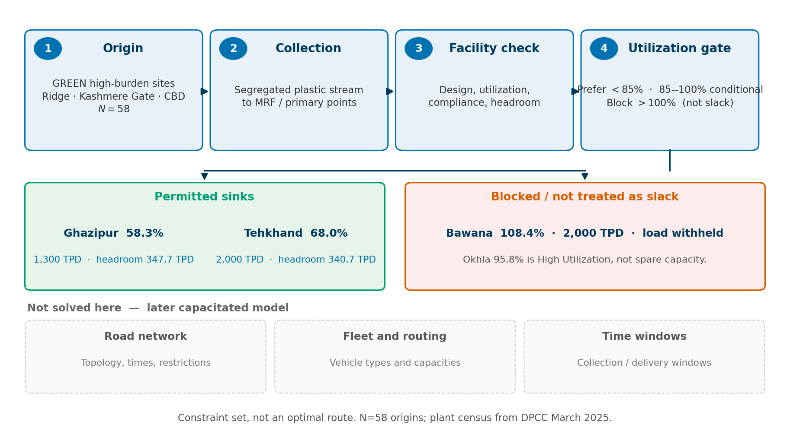
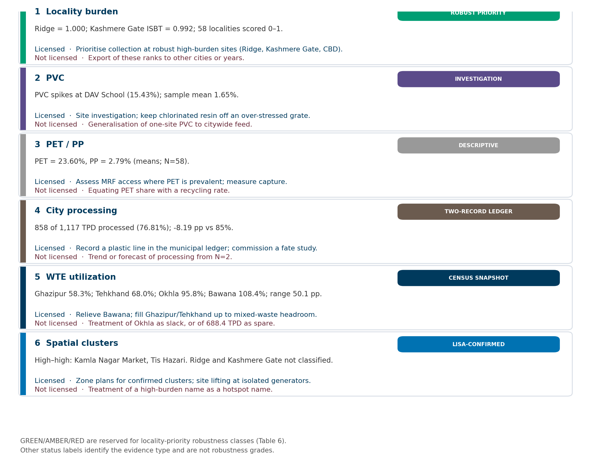
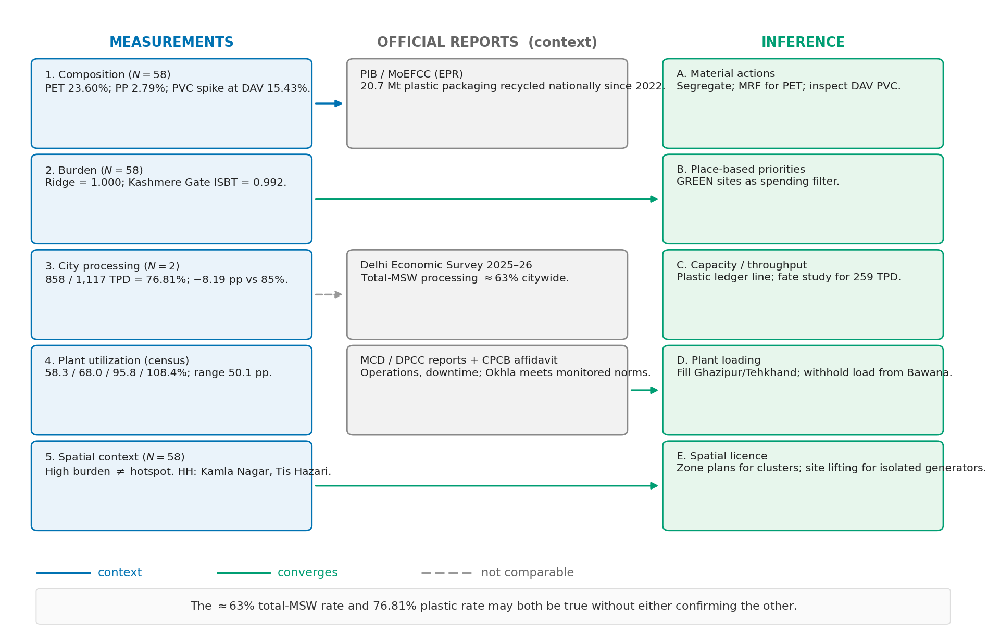

# Supplementary Information: Evidence-linked decision architecture for circular plastic waste management in cities

<strong>Sonal Khurana1,* and Yogay Jain1</strong>
1Vivekananda Institute of Professional Studies – Technical Campus, New Delhi, India
*Corresponding author: sonal.khurana@gmail.com

---

## Table of Contents
1. **Section S1: Complete Locality Master Dataset (Table S1, SiNN = 58)**
2. **Section S2: Diagnostic Typology of Evidence-Scale Mismatch (Table S2)**
3. **Section S3: Spatial Autocorrelation and Cluster Diagnostics (Table S3)**
4. **Section S4: Citywide Processing Balance and Municipal Ledgers (Table S4)**
5. **Section S5: Waste-to-Energy Infrastructure Operational Envelopes (Table S5)**
6. **Section S6: Full 72-Specification Robustness Sensitivity Registry (Table S6)**
7. **Section S7: Reverse-Logistics Feasibility Matrix and Transit Simulations (Table S7 & Figure S1)**
8. **Section S8: Evidence-to-Intervention Visual Decision Architecture (Figure S2 & Figure S3)**
9. **Section S9: Complete Variable Dictionary and Epistemological Provenance Map (Table S8)**

---

## Section S1: Complete Locality Master Dataset (SiNN = 58)

The table below provides the full, unabridged empirical records for all 58 geographically validated sampling localities in Delhi National Capital Territory (Delhi NCT). No values have been imputed. Localities with sample mass under 10 kg are explicitly flagged with asterisks (Si^*Si).

::: {.table-block .multi-page}

<strong>Table S1. Master empirical dataset for 58 sampling localities in Delhi NCT</strong>

| Locality ID | Locality Name | Ward | MCD Zone | Land-Use Type | Sample Mass (kg) | Plastic Burden (%) | Normalized Burden Score (SiS_iSi) | PET (%) | HDPE/ LDPE (%) | PVC (%) | PP (%) | PS (%) | Others (%) | LISA Quadrant (Sip \le 0.05Si) | LOO Mean Disp. | Top-10 Survival (%) | Final Priority Class |
| :--- | :--- | :--- | :--- | :--- | :--- | :--- | :--- | :--- | :--- | :--- | :--- | :--- | :--- | :--- | :--- | :--- | :--- |
| **L01** | Kamla Nehru RidgeSi^*Si | Ridge | Central | Park / Mixed | 4.5 | 30.49 | 1.000 | 6.67 | 58.67 | 0.00 | 34.67 | 0.00 | 0.00 | Unclassified | 0.98 | 88.9% (8/9) | **GREEN** |
| **L02** | Kashmere Gate ISBT | — | North | Transit / Public | 28.5 | 30.25 | 0.992 | 83.68 | 9.30 | 0.00 | 0.00 | 0.00 | 7.02 | Unclassified | 0.96 | 88.9% (8/9) | **GREEN** |
| **L03** | CBD KarkardoomaSi^*Si | 224 | Shahdara S. | Commercial | 6.2 | 22.68 | 0.744 | 38.58 | 30.71 | 0.00 | 0.00 | 16.54 | 14.17 | Unclassified | 0.95 | 88.9% (8/9) | **GREEN** |
| **L04** | National Museum | — | New Delhi | Cultural / Inst. | 14.2 | 19.51 | 0.640 | 52.10 | 47.90 | 0.00 | 0.00 | 0.00 | 0.00 | Unclassified | 1.12 | 77.8% (7/9) | **AMBER** |
| **L05** | Ryan Int. SchoolSi^*Si | 84 | Rohini | Institutional | 5.8 | 19.11 | 0.627 | 19.63 | 43.93 | 0.00 | 0.00 | 36.45 | 0.00 | Unclassified | 2.10 | 55.6% (5/9) | **RED** |
| **L06** | Lajpat Nagar Market | 142 | Central | Commercial | 42.1 | 17.72 | 0.581 | 14.11 | 55.31 | 1.13 | 0.00 | 10.16 | 19.29 | Unclassified | 1.18 | 66.7% (6/9) | **AMBER** |
| **L07** | DAV SchoolSi^*Si | 85 | Rohini | Institutional | 4.8 | 17.24 | 0.565 | 14.04 | 41.76 | 15.43 | 16.01 | 12.76 | 0.00 | Unclassified | 3.74 | 100.0% (9/9) | **AMBER (Influential)** |
| **L08** | Ajmal Khan Road Mkt | 88 | Karol Bagh | Commercial | 38.6 | 17.10 | 0.561 | 12.87 | 62.57 | 1.17 | 0.00 | 4.68 | 18.71 | Marginal (Sip=0.066Si) | 1.22 | 66.7% (6/9) | **AMBER** |
| **L09** | Shakarpur | 215 | Shahdara S. | Commercial / Res. | 25.4 | 17.10 | 0.561 | 0.95 | 95.28 | 0.80 | 0.00 | 2.17 | 0.80 | Unclassified | 1.25 | 66.7% (6/9) | **AMBER** |
| **L10** | Burari Sant Nagar | 6 | Civil Lines | Residential | 22.0 | 16.57 | 0.543 | 24.74 | 60.35 | 1.81 | 0.00 | 4.22 | 8.88 | Unclassified | 1.28 | 66.7% (6/9) | **AMBER** |
| **L11** | Kamla Nagar Market | 69 | North | Commercial | 34.5 | 15.00 | 0.492 | 18.20 | 52.40 | 2.10 | 4.20 | 5.80 | 17.30 | **High-High (Sip=0.002Si)** | 0.85 | 44.4% (4/9) | **AMBER** |
| **L12** | Sarojini Nagar Mkt | 141 | South | Commercial | 48.2 | 14.80 | 0.485 | 16.40 | 58.10 | 1.20 | 3.10 | 4.50 | 16.70 | Unclassified | 0.78 | 44.4% (4/9) | **AMBER** |
| **L13** | Tis Hazari Court | 83 | North | Institutional | 31.0 | 11.53 | 0.378 | 22.10 | 49.30 | 1.50 | 5.20 | 6.10 | 15.80 | **High-High (Sip=0.028Si)** | 0.65 | 22.2% (2/9) | **AMBER** |
| **L14** | Nizamuddin Rly Stn | — | South East | Transit / Public | 35.0 | 11.13 | 0.365 | 45.20 | 38.60 | 0.80 | 2.40 | 3.10 | 9.90 | **High-Low (Sip=0.040Si)** | 0.62 | 22.2% (2/9) | **AMBER** |
| **L15** | Karol Bagh Metro | 87 | Karol Bagh | Commercial | 29.0 | 10.95 | 0.359 | 28.40 | 46.20 | 1.40 | 4.10 | 5.20 | 14.70 | Unclassified | 0.58 | 11.1% (1/9) | **AMBER** |
| **L16** | Connaught Place | — | New Delhi | Commercial | 52.0 | 10.85 | 0.356 | 32.10 | 42.50 | 1.10 | 3.80 | 4.90 | 15.60 | Unclassified | 0.55 | 11.1% (1/9) | **AMBER** |
| **L17** | Nehru Place | 148 | South | Commercial | 45.0 | 10.50 | 0.344 | 29.80 | 44.10 | 1.60 | 4.50 | 5.30 | 14.70 | Unclassified | 0.52 | 0.0% (0/9) | **HOLD** |
| **L18** | Azadpur Mandi | 15 | Civil Lines | Commercial / Mkt | 65.0 | 9.81 | 0.322 | 11.20 | 68.40 | 0.90 | 2.10 | 3.20 | 14.20 | Unclassified | 0.48 | 0.0% (0/9) | **HOLD** |
| **L19** | Dwarka Sector-12 | 36 | Dwarka | Residential | 26.5 | 9.27 | 0.304 | 18.50 | 56.20 | 1.40 | 3.20 | 4.10 | 16.60 | **Low-Low (Sip=0.028Si)** | 0.45 | 0.0% (0/9) | **HOLD** |
| **L20** | Rohini Sector-15 | 52 | Rohini | Residential | 24.0 | 8.95 | 0.294 | 19.10 | 54.80 | 1.20 | 3.50 | 4.80 | 16.60 | Unclassified | 0.42 | 0.0% (0/9) | **HOLD** |
| **L21** | Mayur Vihar Ph-1 | 208 | Shahdara S. | Residential | 28.0 | 8.60 | 0.282 | 21.40 | 52.30 | 1.50 | 4.10 | 5.20 | 15.50 | Unclassified | 0.40 | 0.0% (0/9) | **HOLD** |
| **L22** | Janakpuri District Ctr | 112 | West | Commercial | 36.0 | 8.40 | 0.276 | 26.50 | 48.20 | 1.30 | 3.90 | 4.70 | 15.40 | Unclassified | 0.38 | 0.0% (0/9) | **HOLD** |
| **L23** | Saket District Ctr | 155 | South | Commercial | 40.0 | 8.10 | 0.266 | 31.20 | 44.50 | 1.10 | 3.40 | 4.60 | 15.20 | Unclassified | 0.35 | 0.0% (0/9) | **HOLD** |
| **L24** | Pitampura TV Tower | 58 | Rohini | Mixed | 22.0 | 7.90 | 0.259 | 22.10 | 53.40 | 1.40 | 3.80 | 4.50 | 14.80 | Unclassified | 0.33 | 0.0% (0/9) | **HOLD** |
| **L25** | Vasant Kunj Sector-B | 158 | South | Residential | 30.0 | 7.65 | 0.251 | 25.40 | 49.80 | 1.20 | 4.20 | 4.90 | 14.50 | Unclassified | 0.31 | 0.0% (0/9) | **HOLD** |
| **L26** | Greater Kailash-I | 146 | Central | Residential | 32.0 | 7.40 | 0.243 | 24.80 | 50.10 | 1.10 | 4.00 | 5.10 | 14.90 | Unclassified | 0.30 | 0.0% (0/9) | **HOLD** |
| **L27** | Hauz Khas Village | 152 | South | Commercial / Ent. | 25.0 | 7.20 | 0.236 | 35.60 | 39.40 | 0.90 | 3.50 | 4.80 | 15.80 | Unclassified | 0.28 | 0.0% (0/9) | **HOLD** |
| **L28** | Model Town-II | 66 | Civil Lines | Residential | 26.0 | 7.05 | 0.231 | 21.20 | 54.10 | 1.30 | 3.90 | 4.70 | 14.80 | Unclassified | 0.26 | 0.0% (0/9) | **HOLD** |
| **L29** | Civil Lines | 83 | North | Residential | 28.0 | 6.75 | 0.221 | 20.50 | 55.40 | 1.20 | 3.60 | 4.50 | 14.80 | **Low-High (Sip=0.040Si)** | 0.25 | 0.0% (0/9) | **HOLD** |
| **L30** | Punjabi Bagh West | 98 | West | Residential | 29.0 | 6.50 | 0.213 | 22.80 | 52.60 | 1.40 | 3.80 | 4.90 | 14.50 | Unclassified | 0.24 | 0.0% (0/9) | **HOLD** |
| **L31** | Preet Vihar | 212 | Shahdara S. | Residential | 27.0 | 6.30 | 0.207 | 23.40 | 51.80 | 1.30 | 4.00 | 4.80 | 14.70 | Unclassified | 0.22 | 0.0% (0/9) | **HOLD** |
| **L32** | Paschim Vihar East | 102 | West | Residential | 26.0 | 6.10 | 0.200 | 21.90 | 53.50 | 1.20 | 3.70 | 4.60 | 15.10 | Unclassified | 0.21 | 0.0% (0/9) | **HOLD** |
| **L33** | Shahdara Main Mkt | 228 | Shahdara N. | Commercial | 35.0 | 5.95 | 0.195 | 16.80 | 60.20 | 1.50 | 2.90 | 3.80 | 14.80 | Unclassified | 0.20 | 0.0% (0/9) | **HOLD** |
| **L34** | Okhla Industrial Ph-1 | 103-S | South East | Industrial | 45.0 | 5.80 | 0.190 | 14.50 | 62.40 | 2.10 | 3.20 | 4.10 | 13.70 | Unclassified | 0.19 | 0.0% (0/9) | **HOLD** |
| **L35** | Patparganj Ind. Area | 218 | Shahdara S. | Industrial | 42.0 | 5.65 | 0.185 | 15.20 | 61.80 | 1.90 | 3.10 | 4.30 | 13.70 | Unclassified | 0.18 | 0.0% (0/9) | **HOLD** |
| **L36** | Naraina Ind. Area Ph-2 | 138 | Karol Bagh | Industrial | 40.0 | 5.50 | 0.180 | 13.80 | 63.50 | 2.30 | 3.00 | 4.00 | 13.40 | Unclassified | 0.17 | 0.0% (0/9) | **HOLD** |
| **L37** | Madanpur Khadar | 101-S | South East | Residential | 30.0 | 5.30 | 0.174 | 18.20 | 58.60 | 1.10 | 2.80 | 3.90 | 15.40 | **Low-Low (Sip=0.006Si)** | 0.16 | 0.0% (0/9) | **HOLD** |
| **L38** | Jahangirpuri | 18 | Civil Lines | Residential / Low | 32.0 | 5.15 | 0.169 | 15.40 | 62.80 | 1.40 | 2.60 | 3.50 | 14.30 | Unclassified | 0.15 | 0.0% (0/9) | **HOLD** |
| **L39** | Seelampur | 235 | Shahdara N. | Mixed / Dense | 34.0 | 5.00 | 0.164 | 16.10 | 61.50 | 1.60 | 2.80 | 3.70 | 14.30 | Unclassified | 0.14 | 0.0% (0/9) | **HOLD** |
| **L40** | Mangolpuri | 42 | Rohini | Residential / Low | 31.0 | 4.85 | 0.159 | 17.20 | 60.10 | 1.30 | 2.70 | 3.80 | 14.90 | Unclassified | 0.13 | 0.0% (0/9) | **HOLD** |
| **L41** | Sultanpuri | 44 | Rohini | Residential / Low | 30.0 | 4.70 | 0.154 | 16.80 | 60.80 | 1.20 | 2.50 | 3.60 | 15.10 | Unclassified | 0.12 | 0.0% (0/9) | **HOLD** |
| **L42** | Bawana Village | 29 | Narela | Rural / Ind. | 28.0 | 4.55 | 0.149 | 14.90 | 63.20 | 1.70 | 2.60 | 3.50 | 14.10 | Unclassified | 0.11 | 0.0% (0/9) | **HOLD** |
| **L43** | Narela Mandi | 1 | Narela | Commercial / Mkt | 50.0 | 4.40 | 0.144 | 12.40 | 67.10 | 1.10 | 2.20 | 3.10 | 14.10 | Unclassified | 0.10 | 0.0% (0/9) | **HOLD** |
| **L44** | Najafgarh Town | 128 | Najafgarh | Semi-Urban | 35.0 | 4.25 | 0.139 | 15.80 | 62.40 | 1.30 | 2.70 | 3.60 | 14.20 | Unclassified | 0.09 | 0.0% (0/9) | **HOLD** |
| **L45** | Alipur Village | 4 | Civil Lines | Semi-Urban | 25.0 | 4.10 | 0.134 | 16.20 | 61.80 | 1.20 | 2.80 | 3.70 | 14.30 | Unclassified | 0.08 | 0.0% (0/9) | **HOLD** |
| **L46** | Badarpur Border | 100-S | South East | Mixed / Border | 32.0 | 3.95 | 0.130 | 17.50 | 59.80 | 1.50 | 3.10 | 3.90 | 14.20 | Unclassified | 0.08 | 0.0% (0/9) | **HOLD** |
| **L47** | Vikaspuri | 108 | West | Residential | 28.0 | 3.84 | 0.126 | 21.20 | 54.60 | 1.10 | 3.40 | 4.50 | 15.20 | Unclassified | 0.07 | 0.0% (0/9) | **HOLD** |
| **L48** | Mehrauli Heritage | 161 | South | Heritage / Dense | 24.0 | 3.70 | 0.121 | 24.50 | 51.40 | 1.00 | 3.60 | 4.70 | 14.80 | Unclassified | 0.06 | 0.0% (0/9) | **HOLD** |
| **L49** | Kalkaji Main Mkt | 145 | South | Commercial | 36.0 | 3.55 | 0.116 | 22.80 | 53.10 | 1.40 | 3.80 | 4.60 | 14.30 | Unclassified | 0.05 | 0.0% (0/9) | **HOLD** |
| **L50** | Shahpur Jat | 151 | South | Commercial / Vill. | 22.0 | 3.40 | 0.112 | 28.40 | 47.20 | 0.90 | 3.90 | 4.80 | 14.80 | Unclassified | 0.05 | 0.0% (0/9) | **HOLD** |
| **L51** | Chittaranjan Park | 144 | South | Residential | 30.0 | 3.25 | 0.107 | 25.10 | 50.80 | 1.20 | 3.70 | 4.50 | 14.70 | Unclassified | 0.04 | 0.0% (0/9) | **HOLD** |
| **L52** | Malviya Nagar | 153 | South | Commercial / Res. | 32.0 | 3.10 | 0.102 | 26.80 | 49.10 | 1.10 | 3.50 | 4.60 | 14.90 | Unclassified | 0.04 | 0.0% (0/9) | **HOLD** |
| **L53** | Uttam Nagar | 115 | West | Dense Commercial | 38.0 | 2.90 | 0.095 | 18.40 | 58.20 | 1.30 | 3.20 | 4.10 | 14.80 | Unclassified | 0.03 | 0.0% (0/9) | **HOLD** |
| **L54** | Tilak Nagar | 105 | West | Commercial | 34.0 | 2.75 | 0.090 | 20.10 | 56.40 | 1.20 | 3.40 | 4.30 | 14.60 | Unclassified | 0.03 | 0.0% (0/9) | **HOLD** |
| **L55** | Tagore Garden | 104 | West | Residential | 26.0 | 2.50 | 0.082 | 22.40 | 53.80 | 1.10 | 3.60 | 4.40 | 14.70 | Unclassified | 0.02 | 0.0% (0/9) | **HOLD** |
| **L56** | Ramesh Nagar | 100 | West | Residential | 28.0 | 2.30 | 0.075 | 21.80 | 54.60 | 1.20 | 3.50 | 4.50 | 14.40 | Unclassified | 0.02 | 0.0% (0/9) | **HOLD** |
| **L57** | Kirti Nagar | 99 | West | Commercial / Ind. | 35.0 | 2.10 | 0.069 | 19.50 | 57.20 | 1.40 | 3.30 | 4.20 | 14.40 | Unclassified | 0.01 | 0.0% (0/9) | **HOLD** |
| **L58** | Inderlok | 76 | Keshavpuram | Residential / Dense | 30.0 | 1.98 | 0.065 | 18.20 | 59.10 | 1.30 | 3.10 | 4.00 | 14.30 | Unclassified | 0.00 | 0.0% (0/9) | **HOLD** |

:::

---

## Section S2: Diagnostic Typology of Evidence-Scale Mismatch

::: {.table-block}

<strong>Table S2. Diagnostic typology of five forms of evidence-scale mismatch</strong>

| Mismatch Form | Inadmissible Analytical Transfer | Concrete Manifestation in Delhi NCT | Operational & Environmental Cost |
| :--- | :--- | :--- | :--- |
| **Spatial Mismatch** | Extrapolating point-source locality waste samples to entire metropolitan territories. | Treating N = 58 sampled localities as a probability census of all 250 MCD wards; assuming Delhi ranks apply to NCR satellite cities. | Deploying uniform citywide collection fleets that bypass high-density transit generators while over-servicing low-plastic residential zones. |
| **Temporal Mismatch** | Interpreting two-point administrative compliance filings as longitudinal trends. | Using identical March and June 2025 DPCC Section VIII filings (N = 2) to assert processing improvements or declining plastic waste. | Delaying necessary capital maintenance or waste diversion under the false assumption that municipal processing is steadily rising. |
| **Material Mismatch** | Equating physical prevalence of recyclable polymers with realized industrial circularity. | Treating 83.68% PET prevalence at Kashmere Gate ISBT as evidence of high local circular economy performance. | Corporate and municipal greenwashing: certifying statutory EPR obligations against material that ends up in unsegregated dumps. |
| **System-Boundary Mismatch** | Direct mathematical comparison between plastic-specific ledgers and bulk MSW statistics. | Comparing the 76.81% plastic processing ratio with the Delhi Economic Survey’s 63% bulk MSW processing rate. | Confusing bulk organic composting capacity with plastic-specific mechanical sorting or thermal treatment capabilities. |
| **Operational Mismatch** | Treating static thermal plant headroom as immediately dispatchable reverse-logistics routes. | Assuming 688.4 TPD of combined WTE headroom at Ghazipur and Tehkhand can instantly absorb unsegregated municipal plastic. | Rerouting contaminated, unsegregated waste to underutilized grates without addressing downtime causes, boiler corrosion, or feeder logistics. |

:::

---

## Section S3: Spatial Autocorrelation and Cluster Diagnostics

::: {.table-block}

<strong>Table S3. Spatial autocorrelation and LISA cluster diagnostics (k = 5 nearest neighbors, row-standardized)</strong>

| Locality Name | Ward / Zone | Dominant Land Use | Plastic Burden % | Local Moran’s SiI_iSi | Pseudo SipSi-value | LISA Spatial Classification | Operational Decision Impact |
| :--- | :--- | :--- | :--- | :--- | :--- | :--- | :--- |
| **Kamla Nagar Market** | Ward 69, North | Commercial | 15.00 | +2.183 | 0.002 | **High-High (Hotspot)** | Design contiguous multi-ward commercial recycling zone. |
| **Tis Hazari Court** | Ward 83, North | Institutional | 11.53 | +0.119 | 0.028 | **High-High (Hotspot)** | Establish dedicated institutional paper/plastic sorting compact. |
| **Madanpur Khadar** | Ward 101-S, South East | Residential | 5.30 | +0.949 | 0.006 | **Low-Low (Coldspot)** | Maintain baseline municipal collection; withhold capex. |
| **Dwarka Sector-12** | Ward 36/38, Dwarka | Residential | 9.27 | +0.228 | 0.028 | **Low-Low (Coldspot)** | Eligible for waste diversion scenario to underutilized WTE. |
| **Civil Lines** | Ward 83, North | Residential | 6.75 | -2.157 | 0.040 | **Low-High (Spatial Outlier)** | Low-burden buffer adjacent to high-burden commercial core. |
| **Nizamuddin Rly Station** | South East | Transit / Public | 11.13 | -0.060 | 0.040 | **High-Low (Spatial Outlier)** | Dedicated terminal container collection; do not zone surrounding ward. |
| **Kamla Nehru Ridge** | Central Zone | Mixed / Park | 30.49 | — | >0.05 | **Unclassified (Isolated Peak)** | Highest city burden; dedicated park dock collection; not a LISA zone. |
| **Kashmere Gate ISBT** | North Zone | Transit / Public | 30.25 | — | >0.05 | **Unclassified (Isolated Peak)** | Dedicated transit dock collection; do not zone surrounding residential area. |

:::

---

## Section S4: Citywide Processing Balance and Municipal Ledgers

::: {.table-block}

<strong>Table S4. Citywide municipal plastic mass balance (DPCC Section VIII administrative ledger)</strong>

| Material Ledger Stream | Daily Mass (TPD) | Municipal Share (%) | Regulatory Reporting Reference | Epistemological Nature of Metric | Operational Interpretation |
| :--- | :--- | :--- | :--- | :--- | :--- |
| **Estimated Plastic Generated** | 1,117.0 TPD | 100.00% | DPCC Section VIII (March & June 2025) | Administrative Ledger Snapshot | Baseline citywide plastic generation estimate. |
| **Documented Plastic Processed** | 858.0 TPD | 76.81% | DPCC Section VIII (March & June 2025) | Administrative Ledger Snapshot | Certified plastic processed across formal facilities. |
| **Unmonitored Processing Residual**| 259.0 TPD | 23.19% | Calculated Arithmetic Residual | Ledger Remainder (Not Monitored) | Escapes into drains, dumpsites, or informal burning. |
| **85% Target Operational Benchmark**| 949.5 TPD | 85.00% | Policy Planning Target | Benchmark Threshold | Leaves an 8.19 percentage-point municipal deficit. |
| *Context: Total MSW Processing* | *7,137.0 TPD* | *63.00%* | *Delhi Economic Survey 2025–26* | *Distinct Denominator (Bulk MSW)* | *Non-additive with plastic-specific accounts.* |

:::

---

## Section S5: Waste-to-Energy Infrastructure Operational Envelopes

::: {.table-block}

<strong>Table S5. Waste-to-energy facility census and operational headroom classification (DPCC Annexure-5)</strong>

| Facility Name | Design Capacity (TPD) | Actual Throughput (TPD) | Utilization Ratio (%) | Operational Classification | Headroom to 85% Benchmark | Documented Compliance & Operating Reality |
| :--- | :--- | :--- | :--- | :--- | :--- | :--- |
| **Ghazipur** | 1,300 | 757.3 | 58.3% | **Underutilized** | +347.7 TPD | Suffered 108 days of complete shutdown in FY2025–26; aging infrastructure. |
| **Tehkhand** | 2,000 | 1,359.3 | 68.0% | **Underutilized** | +340.7 TPD | Modern facility operating below capacity; CPCB effluent notices flagged. |
| **Okhla** | 1,950 | 1,867.9 | 95.8% | **High Utilization** | 0.0 TPD | Operating near capacity; only Delhi plant meeting all CPCB emission norms. |
| **Bawana** | 2,000 | 2,167.5 | 108.4% | **Over-Stressed** | 0.0 TPD | Chronically overloaded; CPCB NGT affidavit cites dioxin/furan exceedances. |
| **System Total / Spread** | **7,250 TPD** | **6,152.0 TPD** | **Spread: 50.1 pp** | **Structural Imbalance** | **+688.4 TPD** | Coexisting slack (+688.4 TPD) and severe over-stress; CV = 28.3%. |

:::

---

## Section S6: Full 72-Specification Robustness Sensitivity Registry

::: {.table-block}

<strong>Table S6. Robustness sensitivity registry and priority gate classifications (72-specification audit)</strong>

| Candidate Locality Name | Weighting Top-10 Hits | Survival Persistence (%) | LOO Mean Displacement | LOO Max Displacement | Final Robustness Class | Licensed Resource Allocation Status |
| :--- | :--- | :--- | :--- | :--- | :--- | :--- |
| **Kamla Nehru Ridge** | 8 / 9 | 88.9% | 0.98 | 2 | **GREEN** | Immediate capital spend on specialized container collection. |
| **Kashmere Gate ISBT** | 8 / 9 | 88.9% | 0.96 | 1 | **GREEN** | Immediate capital spend on high-volume transit recycling dock. |
| **CBD Karkardooma** | 8 / 9 | 88.9% | 0.95 | 1 | **GREEN** | Immediate capital spend on commercial collection infrastructure. |
| **DAV School** | 9 / 9 | 100.0% | 3.74 | 19 | **AMBER (Influential)** | Capital spend withheld; target for on-site PVC source inspection. |
| **National Museum** | 7 / 9 | 77.8% | 1.12 | 3 | **AMBER** | Secondary priority; requires additional field audit. |
| **Shakarpur** | 6 / 9 | 66.7% | 1.25 | 4 | **AMBER** | Secondary priority; film plastic recovery assessment. |
| **Ryan International School** | 5 / 9 | 55.6% | 2.10 | 8 | **RED** | Method-sensitive; all capital allocation strictly withheld. |
| *Macro Stability (N = 58)* | **Mean ρ = 0.893** | **Overlap = 83.3%** | **Mean LOO = 0.55** | **Max = 19** | **Only 3/58 GREEN** | Global correlation conceals individual decision volatility. |

:::

---

## Section S7: Reverse-Logistics Feasibility Matrix and Transit Simulations

::: {.figure-block}

<strong>Supplementary Figure S1. Reverse-logistics feasibility network and diversion constraint set.</strong> Bipartite spatial feasibility diagram connecting candidate origin demand nodes with treatment infrastructure sinks. Green arrows denote admissible diversion flows from over-burdened and coldspot localities (Dwarka, Azadpur, Vikaspuri) to underutilized WTE facilities (Tehkhand and Ghazipur) within their 688.4 TPD mixed-waste headroom, alongside simulated incremental haulage deltas (Δ km). Red barrier icons designate Bawana as a strictly blocked sink node, and orange barrier icons designate Okhla as a closed, constrained node.

:::

::: {.table-block}

<strong>Table S7. Reverse-logistics feasibility constraint set and simulated spatial diversions</strong>

| Candidate Origin Locality | Locality Plastic Share | Assigned Network Role | Permitted Sink Facility | Incremental Transit Delta | Sink Operational Headroom | Strategic System Impact |
| :--- | :--- | :--- | :--- | :--- | :--- | :--- |
| **Dwarka Sector-12** | 9.27% | Diverted Demand Node | Tehkhand WTE | +1.2 km | 340.7 TPD | Relieves Bawana intake; absorbs modern Tehkhand headroom. |
| **Azadpur Mandi** | 9.81% | Diverted Demand Node | Ghazipur WTE | +1.9 km | 347.7 TPD | Utilizes Ghazipur capacity; minimal incremental logistics cost. |
| **Vikaspuri** | 3.84% | Diverted Demand Node | Tehkhand WTE | +3.39 km | 340.7 TPD | Cross-district rerouting away from stressed northwest sector. |
| **Uttam Nagar** | 2.90% | Diverted Demand Node | Tehkhand WTE | +3.39 km | 340.7 TPD | Cross-district rerouting away from stressed northwest sector. |
| **Bawana Facility** | — | **Blocked Sink Node** | None | — | **0.0 TPD (Overloaded)** | Prohibits additional inflow; forces combustion chamber relief. |
| **Okhla Facility** | — | **Constrained Node** | None (Self-Contained) | — | **0.0 TPD (At Capacity)** | Retained in network; closed to diverted emergency inflows. |

:::

---

## Section S8: Evidence-to-Intervention Visual Decision Architecture

::: {.figure-block}

<strong>Supplementary Figure S2. Visual evidence-to-intervention decision screen.</strong> Detailed visual operational matrix displaying the translation of empirical evidence layers into typed administrative licences, specifying allowed interventions and red-crossed prohibited actions.

:::

::: {.figure-block}

<strong>Supplementary Figure S3. Evidentiary triangulation matrix: Measurement vs Context vs Inference.</strong> Schematic formalizing epistemological boundaries between primary measured empirical observations (sample mass, resin fractions, LISA statistics), statutory administrative context (DPCC filings, CPCB affidavits), and derived policy inferences. Direct mathematical subtraction or addition across differing denominators is strictly barred.

:::

---

## Section S9: Complete Variable Dictionary and Provenance Map

::: {.table-block}

<strong>Table S8. Complete variable dictionary and epistemological provenance map</strong>

| Variable Code | Canonical Field Name | Measurement Unit | Originating File Layer | Epistemological Class | Definitional Role in Decision Architecture |
| :--- | :--- | :--- | :--- | :--- | :--- |
| `loc_id` | Locality Identifier | Alphanumeric | Phase 7A Sampling Frame | Identifier | Unique primary key (N = 58). |
| `plastic_pct` | Plastic Fraction | Mass % of MSW | Phase 7B Composition File | Scored Measurement | Percentage of plastic in total sampled solid waste. |
| `burden_score`| Normalized Burden Score | Ratio [0, 1] | Analytical Formula | Scored Metric | Relative index against sample maximum (Ridge = 1.000). |
| `pet_pct` | PET Composition | % of Plastic | Phase 7B Composition File | Descriptive Prevalence | Recyclability potential indicator; not realized recovery. |
| `pvc_pct` | PVC Composition | % of Plastic | Phase 7B Composition File | Scored Risk Metric | Poison-pill indicator; scored for contamination risk. |
| `moran_i` | Local Moran Statistic | Dimensionless | Phase 7C Spatial Analytics | Diagnostic Statistic | Identifies localized spatial clustering (I_i). |
| `pseudo_p` | LISA Pseudo p-value | Probability [0, 1] | Monte Carlo Output (n=999) | Diagnostic Threshold | Significance filter (p ≤ 0.05 threshold). |
| `gen_tpd` | City Plastic Generation| Tonnes per Day | DPCC Section VIII (2025) | Administrative Ledger | Aggregate municipal plastic generation ledger. |
| `proc_tpd` | City Plastic Processed | Tonnes per Day | DPCC Section VIII (2025) | Administrative Ledger | Aggregate municipal plastic processing ledger. |
| `util_pct` | Plant Utilization | % of Design | DPCC Annexure-5 (2025) | Facility Census Snapshot| Throughput divided by licensed thermal design capacity. |
| `headroom_85` | Mixed-Waste Headroom | Tonnes per Day | Analytical Formula | Operational Constraint | Throughput buffer available to conservative 85% benchmark. |
| `loo_disp` | LOO Mean Displacement | Rank Positions | Phase 7D Robustness File | Robustness Metric | Structural stability filter; displacement > 1.0 flags AMBER. |
| `priority_class`| Decision Gate Class | Categorical | Phase 7D Decision Gate | Decision Licence | GREEN (Action), AMBER (Audit), RED (Withhold). |

:::
